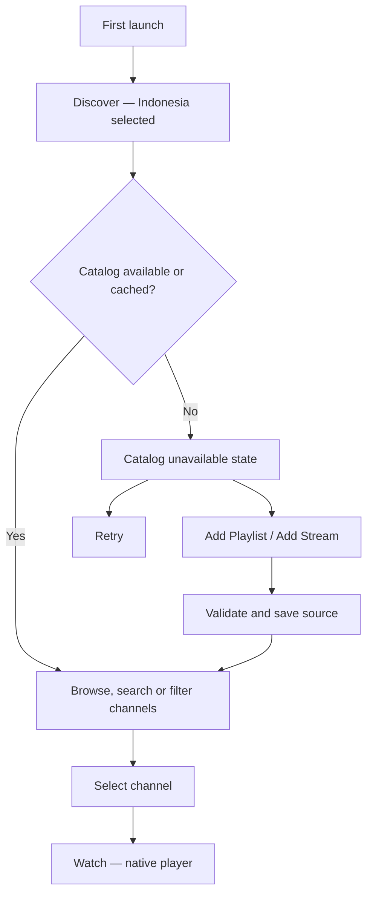
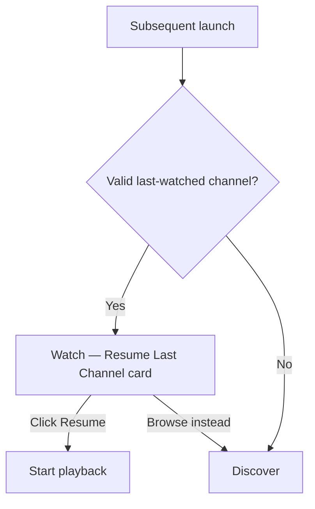
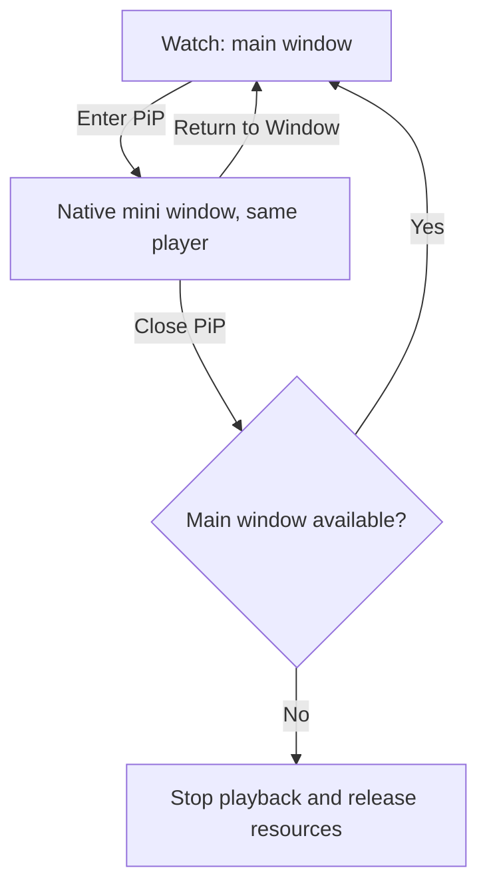
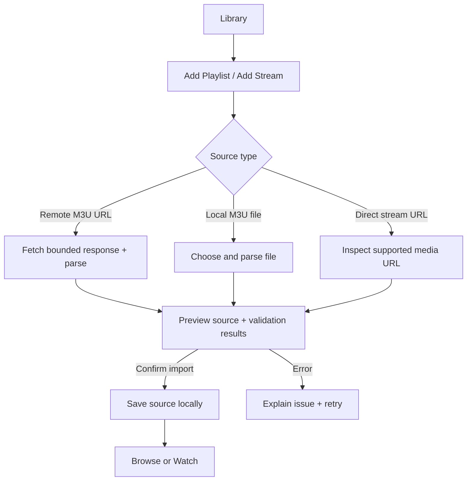

# DESIGN.md — mumu

> Design contract for **mumu**, a native, macOS-first live TV player.  
> Version: **0.1 / design direction** — to be reconciled with the implemented MyGo design system in issue #4.  
> Applies to: MyGo native views, dialogs, window surfaces and PiP.

## 1. Product experience

**Name:** mumu  
**Brand:** Tomato-red mumu with a distinctive, original tomato icon  
**Promise:** **Just TV. Nothing in the way.**

mumu should feel like turning on a well-designed television, not operating an IPTV configuration dashboard.

### Experience pillars

1. **Content first.** Video dominates when watching. UI chrome retreats until needed.
2. **Zero ceremony.** No onboarding, account, login or forced playlist import.
3. **Two audiences, one interface.** Beginners discover channels immediately; power users can manage multiple sources without making the first screen complicated.
4. **Comfortable for long sessions.** Dark charcoal is the base; red is directional, not decorative wallpaper.
5. **Native macOS behavior.** Window resizing, keyboard access, dialogs, focus, drag, PiP and motion respect platform expectations.
6. **Trustworthy state.** Never pretend a stream is available, live-seekable, licensed, or playing when it is not.

### Non-goals for v0.1

- Full EPG/program guide
- Recording and time-shift/DVR timeline (future #15/#16)
- Accounts, synced watch history or cloud-hosted data
- Multi-view playback or a second simultaneous decoding session
- WebView/video embedded in HTML

## 2. Brand identity — tomato, not generic red

### Logo direction

Design an original tomato mark:

- **Silhouette:** friendly rounded tomato body, subtle organic asymmetry, not a perfect circle.
- **Crown:** simplified 3–5 leaf forms, legible at small sizes.
- **Media association:** a tiny negative-space play triangle or screen cue is optional, but never at the expense of recognizable tomato shape.
- **Wordmark:** **Mumu**, approachable rounded letterforms, moderate tracking, substantial enough to read beside a 20–24 pt mark.
- **App icon:** the current mascot in `resources/icon.png`; keep simple shapes, no detailed gradients or miniature labels, and export separately for 16, 32, 64 and 1024 px.

Do not copy an existing TV brand or tomato-logo asset. The first implementations may use a native-drawn placeholder; final vector artwork requires its own asset review.

### Color tokens

Token names are *language-agnostic design values*, **not CSS instructions**. Implement through MyGo's theme/styling APIs after checking the pinned version.

The app ships **Dark** (default), **Light** and **System** appearances. Video stays on `surface.video` in both.

#### Dark appearance

| Token | Hex | Usage |
|---|---|---|
| `brand.tomato` | `#FF4D4D` | Mark, selected accents, small decorative indicators |
| `action.primary` | `#D93636` | Primary button fill where white small text is required |
| `action.primaryHover` | `#C92C2C` | Primary button hover state |
| `action.primaryPressed` | `#B72525` | Primary pressed/active fill |
| `surface.canvas` | `#151517` | Main dark canvas |
| `surface.sidebar` | `#1D1D20` | Navigation area |
| `surface.raised` | `#262629` | Cards, controls and popovers |
| `surface.hover` | `#333338` | Hover and selected dark surfaces |
| `surface.video` | `#09090B` | Video backdrop/letterbox |
| `border.subtle` | `#3A3A3F` | Separators and control outlines |
| `text.primary` | `#F5F5F6` | Headlines, normal important text |
| `text.secondary` | `#B8B8BF` | Descriptions and metadata |
| `text.muted` | `#92929A` | Secondary labels, check contrast in context |
| `state.success` | `#4DC19A` | Confirmed success only |
| `state.warning` | `#F1B85B` | Partial/limited stream capability |
| `state.error` | `#F36B68` | Errors and failed playback |
| `focus.ring` | `#FF4D4D` | Keyboard focus outline |

**Contrast rule:** brand `#FF4D4D` with white text is about **3.27:1**, insufficient for ordinary small text at WCAG AA. Do not place small white labels on raw brand red. Use `action.primary = #D93636` with white text (about **4.63:1**) or dark text on the lighter brand accent when appropriate. Verify exact rendered combinations and focus indicators with accessibility tools.

#### Light appearance

| Token | Hex | Usage |
|---|---|---|
| `surface.canvas` | `#F7F7F8` | Main light canvas |
| `surface.sidebar` | `#EFEFF1` | Navigation area |
| `surface.raised` | `#FFFFFF` | Cards, controls and popovers |
| `surface.hover` | `#E7E7EA` | Hover surfaces |
| `surface.pressed` | `#DDDDE1` | Pressed and selected surfaces |
| `border.subtle` | `#D5D5DA` | Separators and control outlines |
| `text.primary` | `#18181B` | Headlines and important text |
| `text.secondary` | `#52525B` | Descriptions and metadata |
| `text.muted` | `#62626B` | Secondary labels |
| `action.primary` | `#D93636` | Primary fill with white text |
| `state.error` | `#C22B2B` | Errors |
| `state.warning` | `#A16207` | Partial capability |
| `state.success` | `#157F5F` | Confirmed success |
| `focus.ring` | `#D93636` | Keyboard focus outline |

Rendered contrast for both appearances is enforced by `internal/ui/theme_test.go`.

Red is for actionable hierarchy and brand recognition. It must not be the only indication of errors, playback status, or selection. Avoid large red gradients, neon glows, or crimson video overlays.

## 3. Typography, geometry and motion

### Type

Use the macOS system font stack by default (San Francisco where available) through MyGo native text styling; avoid bundling custom fonts without a strong reason.

| Role | Starting size | Weight | Example |
|---|---|---|---|
| Page heading | 26–28 pt | Semibold | Discover |
| Section heading | 17–20 pt | Semibold | Recently watched |
| Body / channel title | 14–15 pt | Regular / Medium | TVRI Nasional |
| Control label | 13–14 pt | Medium | Add Playlist |
| Metadata | 11–12 pt | Regular | Indonesia · News |
| Large quiet placeholder | 20–24 pt | Medium | Nothing playing |

Use restrained type sizes and support text scaling. Never depend on a fixed number of characters fitting in one row.

### Spacing and shape

- Base spacing grid: **4 pt**; common increments: **8, 12, 16, 24, 32 pt**.
- Compact controls: 8–10 pt corners; cards: 12–14 pt; native mini player: 12–16 pt where permitted.
- Sidebar: ~200–224 pt expanded; ~64–72 pt icon-only collapsed. **Starting guidance, not a fixed requirement**.
- Initial design viewport: around 1120 × 720 pt. Validate actual minimum size against player and native titlebar; do not hardcode a single screenshot size.
- Interactive pointer targets: prefer about **32–36 pt** minimum on desktop, with larger hit area for tiny visual icons.
- Video: preserve **16:9** where appropriate with letterboxing; never crop live TV by default.

### Motion

- UI motion is **quiet and functional**: subtle focus, drawer and hover transitions; no perpetual shimmer or gratuitous entrance animation.
- Recommended starting ranges: 120–180 ms for small feedback, 180–240 ms for drawers; adjust to MyGo/native feel.
- Respect **Reduce Motion**, high contrast and text scaling preferences if exposed by MyGo/platform.
- Controls may fade after inactivity while video is playing, but keyboard focus/hover keeps them visible.
- PiP transitions should prioritize **video/audio continuity over animation**; do not promise a smooth morph before #2 proves native surface handoff.

## 4. Information architecture

Three primary destinations; Settings is secondary:

```text
mumu
├── Watch       Active video, controls, compact channel drawer, resume
├── Discover    Browse public/reviewed catalog + imported sources, search/filter
├── Library     Favorites, Recently Watched, My Playlists, Custom Streams
└── Settings    Playback, appearance/accessibility, source diagnostics, About
```

**No dedicated EPG tab in v0.1. No onboarding screens. No separate dashboard.**

The app shell stays consistent between the three destinations. The video should remain uninterrupted when opening the Watch channel drawer; navigate away only according to the user's explicit intent.

### Desktop shell wireframe

```text
┌──────────────────────────────────────────────────────────────────────────┐
│ ● ● ●      🍅 mumu                                           ⚙           │
├───────────────┬──────────────────────────────────────────────────────────┤
│  ▶ Watch      │                                                          │
│  ◈ Discover   │    Current page content                                  │
│  ♡ Library    │    Native MyGo UI                                         │
│               │                                                          │
│               │    Tomato red is a precise accent, not a full surface    │
│               │                                                          │
│  ⚙ Settings   │                                                          │
└───────────────┴──────────────────────────────────────────────────────────┘
```

This is a **behavioral wireframe**, not a demand for custom macOS window controls. Use native titlebar conventions and verified MyGo APIs.

## 5. Launch and resume behavior (locked)

### Flow A — First launch & discovery

**First launch means the first app opening after installation/on fresh local state.** There is **no welcome or onboarding screen**.



UI details:

- Open **Discover** directly and select Indonesia as the initial region (user can change it).
- Display **Add Playlist** without hiding it in advanced settings.
- Fetch public catalog asynchronously; show cached data where possible; no network call should freeze navigation.
- Do **not** autoplay a channel, show an invented popularity score, or imply every listed source is legal/online.
- Only include built-in stream entries that pass the project's content-rights review; iptv-org is discovery data, not blanket authorization.

### Subsequent launch



No surprise audio. Store a last-watched reference only when playback genuinely starts; handle missing/removed sources gracefully.

## 6. Discover — browsing channels

```text
┌─ Discover ──────────────────────────────────────────────────────────────┐
│ Discover                                          [+ Add Playlist]      │
│ [⌕ Search channels, countries or sources...]                         │
│ [Indonesia ▾]  [All categories ▾]  [All sources ▾]                     │
│                                                                        │
│ TV channels                                                            │
│ ┌────────────────────────────────────────────────────────────────────┐ │
│ │ [logo]  TVRI Nasional             Indonesia · General         [♡] │ │
│ │ [logo]  Channel name              Indonesia · News            [♡] │ │
│ │ [logo]  Another source            Indonesia · Entertainment   [♡] │ │
│ └────────────────────────────────────────────────────────────────────┘ │
│                                                                        │
│ Select a channel → Watch; show explicit retry if a stream fails.       │
└────────────────────────────────────────────────────────────────────────┘
```

Requirements:

- Prefer readable, dense-enough **rows** for many channels. Optional grid/list toggle can be deferred; avoid giant promo cards.
- Search by channel name. Support country, category and source filters. Keep source attribution accessible.
- Render a channel logo if available and safe to load; otherwise show a neutral TV glyph or initials.
- If two playlists contain identically named channels, do **not** collapse them solely by display name.
- On an empty catalog, show meaningful actions: Retry, Change filter, Add Playlist.
- `LIVE` means live format/content, **not verified upstream availability**. Do not add green online dots without stream-level evidence.
- Hover and keyboard selection should be distinguishable without relying only on red.

## 7. Watch — live playback experience

```text
┌─ Watch ─────────────────────────────────────────────────────────────────┐
│ [LIVE] TVRI Nasional                                            [♡]     │
│ ┌────────────────────────────────────────────────────────────────────┐  │
│ │                                                                    │  │
│ │                   NATIVE LIBMPV VIDEO SURFACE                      │  │
│ │                  16:9 · letterboxed as needed                      │  │
│ │                                                                    │  │
│ │                                                                    │  │
│ │ [speaker] ━━──────          [Channels]   [PiP]   [Fullscreen]     │  │
│ └────────────────────────────────────────────────────────────────────┘  │
│ Channel drawer (optional): searchable list beside video or overlay      │
└─────────────────────────────────────────────────────────────────────────┘
```

### Watch interaction rules

- Video is the focal point; control overlay appears on hover, key interaction or playback errors and recedes after inactivity.
- Show channel name, actual player status, audio/volume, favorite, fullscreen, PiP, and a compact channel drawer.
- **No fake live progress slider**. Seek/reverse belongs to future time-shift feature when technically supported.
- No EPG dependency; do not block watching if schedule data is absent.
- On rapid channel switching, visibly reflect the newest selection only; display loading state and prevent stale events.
- Never hold the last decoded image as if it were current live playback after a stream fails without indicating error.

### Player state contracts

| State | Visible treatment | Primary action |
|---|---|---|
| Idle / no recent channel | Quiet player placeholder | Browse Channels |
| Recent channel on reopen | Last channel summary | Resume (no autoplay) |
| Loading | Small spinner / loading text, preserve layout | Cancel or choose another |
| Buffering | Non-blocking buffering indicator | Wait / Retry if stalled |
| Playing | Minimal overlay / LIVE when appropriate | Show controls on interaction |
| Unsupported codec or auth | Specific error and optional details | Try another source |
| Stream unavailable / timeout | Human-readable error | Retry / Browse channels |
| Offline | Network state without blaming catalog | Retry / use cached list |

Keep errors specific where possible but avoid exposing credentials in URLs or header values.

## 8. Picture-in-Picture — one player, two views

M0 implementation evidence: [native playback](docs/architecture/native-playback-feasibility.md) and
[PiP](docs/architecture/pip-feasibility.md) are **CONDITIONAL GO** on the tested Apple M3/macOS setup.
The standalone spike moves one retained native OpenGL view between MyGo windows; it does not change the startup UX or constitute the production Watch/PiP design.
Follow-up QA confirms drag, resize, stacking, Spaces and foreign-fullscreen behavior on the tested Mac. Captured visual gaps and OpenGL deprecation remain explicit production risks.

PiP is **mandatory** for mumu v0.1, but its native implementation must first pass [#2's feasibility test](https://github.com/satyawikananda/mumu/issues/2).

```text
STATE 1 — WATCH WINDOW
┌─────────────────────────────────────────┐
│ 🍅 mumu                                 │
│ ┌─────────────────────────────────────┐ │
│ │        Playing native video         │ │
│ │                         [PiP ↗]     │ │
│ └─────────────────────────────────────┘ │
└─────────────────────────────────────────┘
                    │ Click PiP
                    ▼
STATE 2 — FLOATING NATIVE WINDOW
Main Watch: "Playing in Picture-in-Picture"
                              ┌───────────────────────────┐
                              │ Native floating video     │
                              │ [Volume] [Return] [Close] │
                              └───────────────────────────┘
                    │ Return to Window
                    ▼
STATE 3 — WATCH RESTORED
Same logical player session, same channel, no deliberate stream reload.
```



UX specifications:

- Native floating window, approximately 16:9, draggable and resizable with reasonable minimum dimensions.
- Always on top where supported; verify behavior with macOS Spaces/fullscreen/sleep-wake.
- Minimal chrome: volume/mute, Return to Window and Close.
- Main window indicates PiP is active, without a second playing preview.
- No duplicated audio, playback instance, channel buffer, or hidden external mpv window.
- Returning should preserve playback if the surface bridge supports it. If not feasible, record the limitation rather than claiming a seamless transition.

## 9. Library — power without clutter

```text
┌─ Library ───────────────────────────────────────────────────────────────┐
│ Library                                      [+ Add Playlist]           │
│                                                                        │
│ Favorites             [saved channel rows...]                          │
│ Recently watched      [recent channel rows...]                         │
│                                                                        │
│ My Playlists                                                          │
│ ┌────────────────────────────────────────────────────────────────────┐ │
│ │ Indonesia IPTV                 Enabled  ·  Updated recently       │ │
│ │ My Own Channels               Enabled  ·  2 channels             │ │
│ └────────────────────────────────────────────────────────────────────┘ │
│ [+ Add M3U URL]    [Import M3U file]    [Add Stream URL]                │
└────────────────────────────────────────────────────────────────────────┘
```

Source-management interaction:



- Manage **multiple playlists** separately: enabled state, name, refresh, last result, count, removal.
- Refresh should preserve last-known-good channel data when the remote source fails.
- Preserve source identity; missing/removed playlists give a repair action rather than broken shortcuts.
- Advanced stream headers, authentication and decoding details (if later added) should live behind a disclosure control, never in the primary import form.

## 10. Settings — small but useful

Recommended v0.1 sections:

- **Playback:** default volume/mute, hardware decoding preference where supported, network/retry configuration with safe defaults.
- **Sources:** catalog refresh, cache, playlist diagnostics and clear-cache controls.
- **Appearance & accessibility:** theme mode (dark-first; system/light as follow-up if feasible), reduce motion, readable scaling.
- **About:** version, website/repository, licenses, attributions and a clear source-rights statement.

Keep troubleshooting controls behind **Advanced**. Do not expose mpv option names to everyday users unless accompanied by plain-language guidance.

## 11. States, accessibility and performance

### Consistent interaction states

Every actionable view/control should specify: default, hover, keyboard focus, pressed, disabled, loading, success, failure, empty and offline where applicable.

- Focus has a visible outline or equivalent high-contrast indication, not just a red text change.
- Icons always have meaningful accessible names; a heart icon should distinguish **Add to Favorites** from **Remove from Favorites**.
- Support keyboard traversal and Escape for dismissing temporary overlays/dialogs.
- Native file dialogs should be used for imports, not a custom imitation of a web upload widget.
- Never rely on color alone to identify selected stream, error, or live state.
- Keep source loading, searching and image decoding off the UI-critical path; virtualize long channel lists when the verified MyGo API supports it.
- Use genuine player events to update UI. Avoid unnecessarily redrawing large native UI surfaces every video frame.

### Suggested keyboard interactions (confirm conflicts with macOS)

| Intent | Proposal |
|---|---|
| Search channels | `⌘F` in Discover/Library |
| Toggle fullscreen | Native standard fullscreen shortcut when available |
| Escape overlay | `Esc` |
| Open/close channel list | `⌘L` if unclaimed by platform/context |
| Mute/unmute | `M` when player area has focus and text fields do not |
| PiP | Provide visible button first; shortcut can follow |

Do not bind global media keys or steal shortcuts from other applications without explicit user permission.

## 12. Window responsiveness

- **Wide:** expanded sidebar + spacious Watch/Discover content.
- **Medium:** compact sidebar and fewer columns in Discover; Watch retains readable controls.
- **Narrow:** collapse sidebar to icons or a native navigation affordance, avoid clipping; channel list becomes a drawer.
- **PiP:** separate minimal native window, not a miniature copy of the full app shell.

Actual breakpoints depend on the implemented MyGo layout APIs and measured text fit; do not equate desktop points to browser CSS pixels.

## 13. Design review checklist (issue #4 and all UI PRs)

- [ ] Tomato brand is consistent and original; sparse accent over charcoal surfaces.
- [ ] Text/button contrast works at normal desktop sizes, including focus and disabled states.
- [ ] First launch **directly** shows Discover, default Indonesia, Add Playlist visible.
- [ ] Subsequent launch offers explicit Resume and **never** starts audio automatically.
- [ ] Watch prioritizes native video; no EPG/recording/fake seek controls in v0.1.
- [ ] Native PiP interaction follows the single-session contract and tested platform behavior.
- [ ] Empty/loading/buffering/error/offline views have useful actions.
- [ ] No WebView or simulated video canvas as a finished feature.
- [ ] Layout remains usable at smaller/resized macOS windows.
- [ ] Keyboard, screen reader labels, reduced motion and touch/pointer targets have been reviewed.

## 14. Implementation notes and references

This document defines the **UX contract and design tokens**, not literal MyGo function signatures. Before implementation, inspect the pinned MyGo `ui` package for themes, inputs, layout, native menus, window options, drawing and accessibility APIs.

Implementation notes for the shell, theme modes and responsive states live in [`docs/ux/shell.md`](docs/ux/shell.md).

- [MyGo Native UI](https://mygo.egoist.dev/docs/ui)
- [MyGo styling / rendering](https://mygo.egoist.dev/docs/ui/rendering)
- [MyGo architecture](https://mygo.egoist.dev/docs/architecture)
- [M0 playback feasibility](https://github.com/satyawikananda/mumu/issues/1)
- [M0 PiP feasibility](https://github.com/satyawikananda/mumu/issues/2)
- [Design system + native shell](https://github.com/satyawikananda/mumu/issues/4)
- [Discover UI](https://github.com/satyawikananda/mumu/issues/10)
- [Watch UI](https://github.com/satyawikananda/mumu/issues/11)
- [Production PiP](https://github.com/satyawikananda/mumu/issues/12)

**The strongest design choice in mumu is what we do *not* show: fewer panels, fewer colors, no surprise audio, and no complexity between the user and their TV.**
