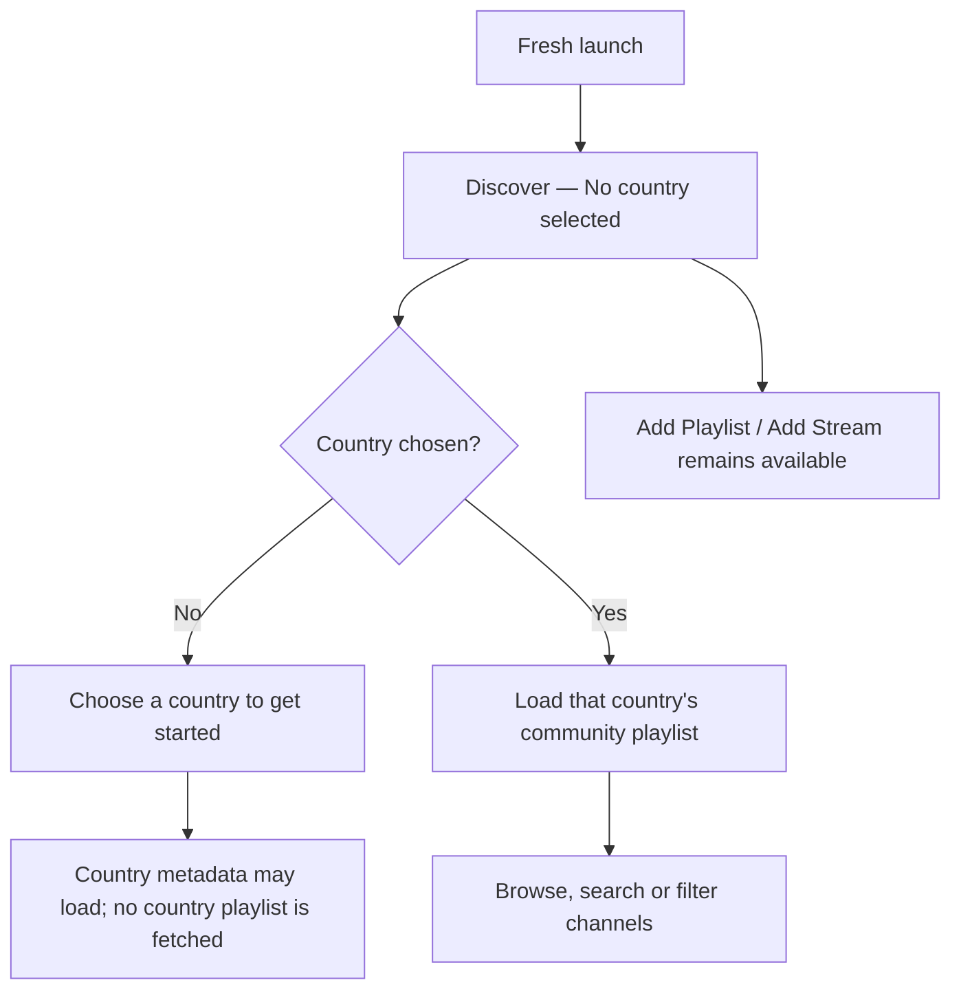
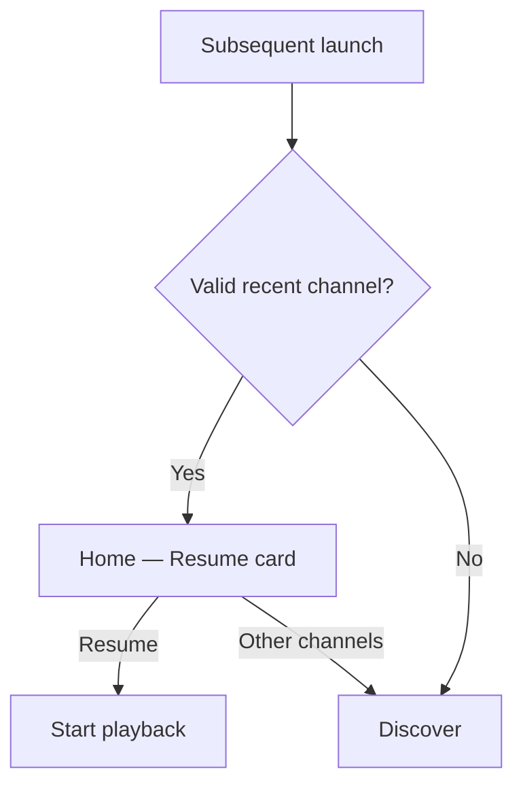
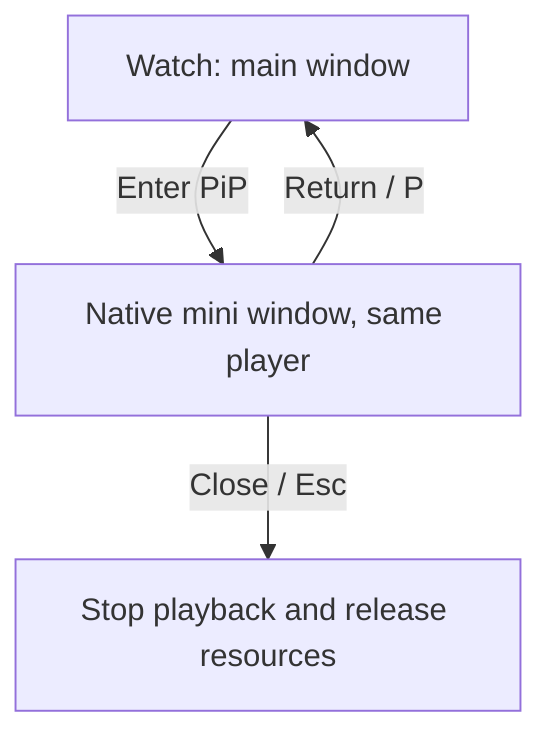
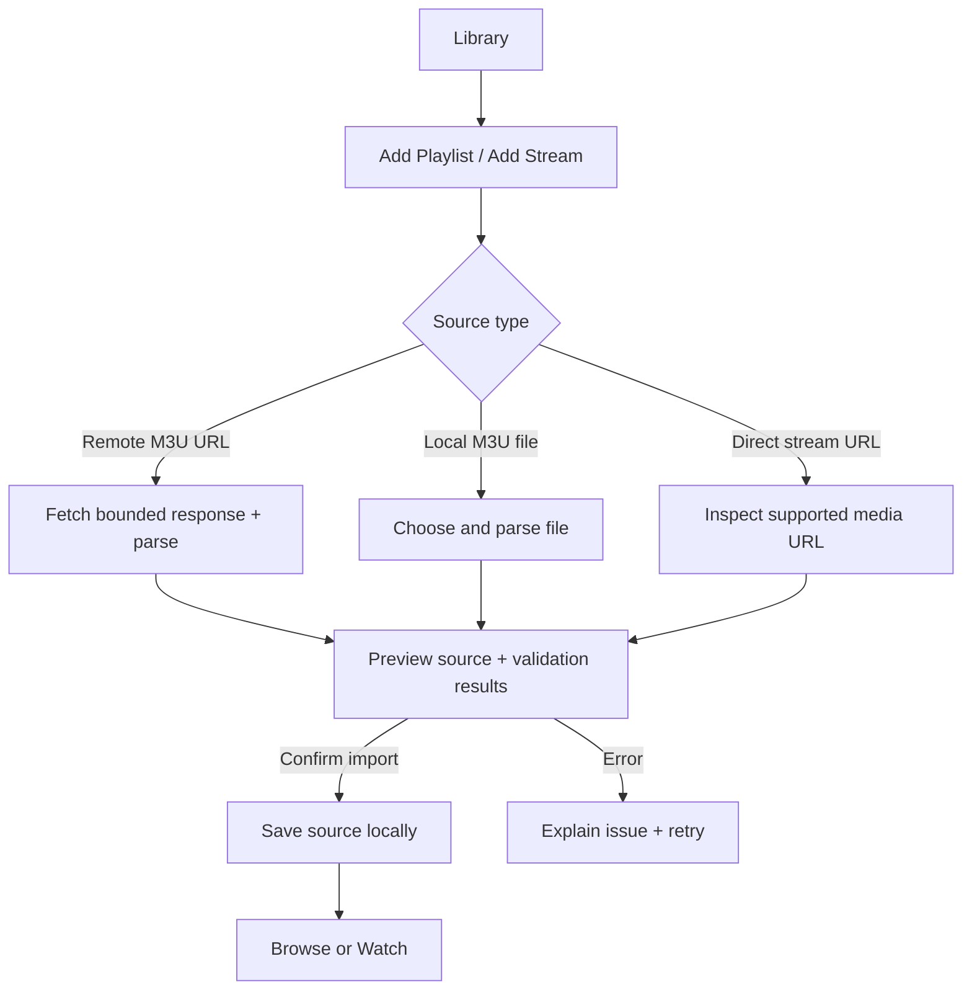

# DESIGN.md — Mumu TV

> Design contract for **Mumu TV**, a native, macOS-first live TV player.
> Component and token source of truth is `internal/ui/tokens.go`.
> Applies to: MyGo native views, dialogs, window surfaces and PiP.

## 1. Product experience

**Name:** Mumu TV
**Brand:** Tomato-red tomato mark with a distinctive, original icon for Mumu TV
**Promise:** **Just TV. Nothing in the way.**

Mumu TV should feel like turning on a well-designed television, not operating an IPTV configuration dashboard.

### Experience pillars

1. **Content first.** Video dominates when watching. UI chrome retreats until needed.
2. **Zero ceremony.** No onboarding, account, login or forced playlist import.
3. **Two audiences, one interface.** Beginners discover channels immediately; power users can manage multiple sources without making the first screen complicated.
4. **Comfortable for long sessions.** Dark charcoal is the base; red is directional, not decorative wallpaper.
5. **Native macOS behavior.** Window resizing, keyboard access, dialogs, focus, drag, PiP and motion respect platform expectations.
6. **Trustworthy state.** Never pretend a stream is available, live-seekable, licensed, or playing when it is not.

### Non-goals for v0.1

- Full EPG/program guide
- Recording and time-shift/DVR timeline
- Accounts, synced watch history or cloud-hosted data
- Multi-view playback or a second simultaneous decoding session
- WebView/video embedded in HTML

## 2. Brand identity — tomato, not generic red

### Logo direction

Design an original tomato mark:

- **Silhouette:** friendly rounded tomato body, subtle organic asymmetry, not a perfect circle.
- **Crown:** simplified 3–5 leaf forms, legible at small sizes.
- **Media association:** a tiny negative-space play triangle or screen cue is optional, but never at the expense of recognizable tomato shape.
- **Wordmark:** **Mumu TV**, approachable rounded letterforms, moderate tracking, substantial enough to read beside a 44 pt header mark.
- **App icon:** the current mascot in `resources/icon.png`; keep simple shapes, no detailed gradients or miniature labels, and export separately for 16, 32, 64 and 1024 px.

Do not copy an existing TV brand or tomato-logo asset. The first implementations may use a native-drawn placeholder; final vector artwork requires its own asset review.

### Color tokens

Token names are language-agnostic design values, not CSS instructions.
Implement them through MyGo's theme/styling APIs. The values and measured
contrast live in `internal/ui/tokens.go`.

The app ships **Dark** (default), **Light** and **System** appearances. Video
stays on `video` in both.

#### Dark appearance

| Token | Hex | Usage |
|---|---|---|
| `bg` | `#0A0A0C` | Window and page canvas |
| `surface` | `#17171C` | Fields, rows, cards |
| `surface-2` | `#23232B` | Hover and raised surfaces |
| `ink` | `#F5F5F7` | Primary text |
| `muted` | `#9298A1` | Secondary text and metadata |
| `brand` | `#F82028` | Brand dot and decorative accent |
| `brand-fill` | `#D93636` | Fill behind white text |
| `ring` | `#FFFFFF` | Keyboard focus ring |
| `border` | `#3A3A3F` | Separators and control outlines |
| `video` | `#09090B` | Video backdrop/letterbox |
| `success` | `#4DC19A` | Confirmed success |
| `warning` | `#F1B85B` | Limited capability, buffering |
| `danger` | `#F36B68` | Error and unavailable |

#### Light appearance

| Token | Hex | Usage |
|---|---|---|
| `bg` | `#F7F7F8` | Main light canvas |
| `surface` | `#FFFFFF` | Cards, controls and popovers |
| `surface-2` | `#E7E7EA` | Hover and raised surfaces |
| `ink` | `#18181B` | Headlines and important text |
| `muted` | `#5C5C63` | Secondary labels |
| `brand` | `#D93636` | Brand accent |
| `brand-fill` | `#C22B2B` | Fill behind white text |
| `ring` | `#18181B` | Keyboard focus ring |
| `border` | `#D5D5DA` | Separators and control outlines |
| `video` | `#09090B` | Video backdrop/letterbox |
| `success` | `#157F5F` | Confirmed success |
| `warning` | `#A16207` | Partial capability |
| `danger` | `#C22B2B` | Errors and failed playback |

**Contrast rule:** `#F82028` with white text is **4.02:1**, below WCAG AA for
normal text. Use `brand-fill` for buttons, LIVE badges and any fill carrying
white text. Keep `#F82028` for dots, decorative accents and non-text marks.
Light focus uses ink because a white ring disappears on a light canvas.

Red is for actionable hierarchy and brand recognition. It must not be the only
indication of errors, playback status or selection. Avoid large red gradients,
neon glows or crimson video overlays.

## 3. Typography, geometry and motion

### Type

Use **Lexend** for display and **Inter Tight** for body, metadata and
controls. Both OFL families are bundled under `internal/ui/fonts/`; the app
does not require a host font or a runtime download. Display requests
`Lexend, Inter Tight`; body requests the theme font.

| Role | Starting size | Weight | Family | Example |
|---|---|---|---|---|
| Display / hero | 76 / 60 / 48 | 700 | Lexend | Metro TV |
| Page title | 26–34 | 600–700 | Lexend | Discover |
| Section / tile title | 19 | 700 | Lexend | Favorites |
| Body / channel title | 15 | 600 | Inter Tight | TVRI Nasional |
| Control label | 13–14 | 500–600 | Inter Tight | Add Playlist |
| Metadata | 12 | 400 | Inter Tight | Indonesia · News |
| Label / LIVE caps | 10 | 700 | Inter Tight | LIVE |
| Keycap / hint | 11 | 600 | Inter Tight | Esc |

Sizes derive from the theme's 14 pt body size with `Theme.Rem`, so desktop text
scaling is respected. Long names wrap to at most two lines in tiles and one
line in rows, with an explicit ellipsis. Never depend on a fixed number of
characters fitting.

### Spacing and shape

- Base spacing grid: **4 pt**; common increments: **8, 12, 16, 24, 32 pt**.
- Compact controls: 8–10 pt corners; cards: 12–14 pt; native mini player: 12–16 pt where permitted.
- Sidebar: ~200–224 pt expanded; ~64–72 pt icon-only collapsed. **Starting guidance, not a fixed requirement**.
- Initial design viewport: around 1120 × 720 pt. Validate actual minimum size against player and native titlebar; do not hardcode a single screenshot size.
- Interactive pointer targets: prefer about **32–36 pt** minimum on desktop, with larger hit area for tiny visual icons.
- Video: preserve **16:9** where appropriate with letterboxing; never crop live TV by default.

### Motion

- UI motion is quiet and functional: hover **160 ms EaseOut**, overlay
  **220 ms smooth**, focus movement **Snappy**.
- Reduced Motion is handled by MyGo: values and poses go to their target at
  once. Do not run a second motion timer.
- Hover may scale or change color. The keyboard ring is a separate state and
  never appears from mouse hover.
- Controls may recede after inactivity while video plays; keyboard focus and
  pointer hover keep them visible.
- PiP transitions prioritize video/audio continuity over animation. Do not
  promise a smooth morph before the native surface handoff proves it.

## 4. Information architecture

Target navigation is **Home**, **Discover** and **Library**, with **Settings**
as a secondary destination. There is no permanent application sidebar.

```text
Mumu TV
├── Home        Valid recent channel, Resume, other channels, recent and favorite rails
├── Discover    Country selection, search, categories, sources, channel grid
├── Library     Favorites, Recently Watched, Playlists, Custom Streams
└── Settings    Appearance/theme, start muted, shortcuts, About
```

- **Home** is a feed, not active playback. It opens only when a valid recent
  channel exists; it never autoplays.
- **Discover** is the fresh-install destination. It starts with no country
  selected.
- **Library** keeps favorites, recent history and source management.
  Curated playlist collections are **v0.2.0** and are not part of this release.
- **Control Center** is the primary navigation/action surface, opened by a
  visible labelled mouse action and by the keyboard. It is contextual over the
  current screen and does not restart playback.
- Settings and category rails are screen-local. They do not create a permanent
  shell sidebar.
- Native titlebar safe areas and macOS window conventions still apply.

### Desktop shell target

```text
┌──────────────────────────────────────────────────────────────────────────┐
│ native title bar                                                         │
├──────────────────────────────────────────────────────────────────────────┤
│ screen-local rail (Settings/category) │ current page content              │
│                                       │                                   │
│                                       │   native MyGo surfaces            │
│                                       │                                   │
└──────────────────────────────────────────────────────────────────────────┘
                    Control Center overlay when requested
```

This is a behavioral contract, not a demand for custom macOS window controls.

### Control Center contract

- One top bar holds the brand, the current destination, a visible labelled
  **Control Center** action and the Settings entry.
- Control Center opens as a native overlay above the current page. It never
  changes the destination, so opening it over Watch keeps the video surface
  attached and playback running.
- Scrim: black vertical gradient, at least 60% over text areas. Backdrop blur
  is not required.
- Context cards use real state only: Resume/Watch, Favorites and Playlists.
  Empty cards say so; no channel names or counts are invented.
- Five approved icons: Home, Discover, Watch, Picture-in-Picture and Close
  Control Center. Library remains reachable from the Favorites and Playlist
  cards; Settings remains reachable from the top-bar gear.
- `FocusGroup` moves cards and icons with the arrows. Enter opens the focused
  action. Escape, outside click and Close dismiss the overlay.
- `Modal` traps focus. Escape restores focus to the opener. The page hint bar
  is hidden while the overlay is open.
- One shortcut registry feeds handlers, hint bars and Settings. `Space` is
  defined and advertised because live pause is implemented.

## 5. Launch and resume behavior (locked)

### Flow A — Fresh install

**Fresh install** means the first app opening after installation or on fresh
local state. There is **no welcome or onboarding screen**.



UI details:

- Open **Discover** directly. Show iptv-org as the source and **Choose a
  country**. Do not preselect Indonesia.
- Country metadata may load before selection. Do **not** fetch or display a
  built-in country playlist until the user chooses one.
- User-imported M3U/custom streams remain usable without a catalog country.
- Do **not** autoplay, show an invented popularity score, or imply every listed
  source is legal or online.
- A failed catalog request must not freeze navigation; offer Retry and Add
  Playlist.

### Subsequent launch



No surprise audio. Store a recent reference only when playback genuinely
starts. Missing or disabled recent entries route safely to Discover.

## 6. Discover — browsing channels

```text
┌─ Discover ──────────────────────────────────────────────────────────────┐
│ Discover                                          [+ Add Playlist]      │
│ [⌕ Search channels, categories or countries...]                         │
│ [Source] [Country] [Live only]              [Search hint /]             │
│                                                                        │
│ Categories          Indonesian channels                                │
│  All channels        ┌──────┐ ┌──────┐ ┌──────┐ ┌──────┐ ┌──────┐     │
│  News                │ tile │ │ tile │ │ tile │ │ tile │ │ tile │     │
│  Kids                └──────┘ └──────┘ └──────┘ └──────┘ └──────┘     │
│  Sport                                                                 │
└─────────────────────────────────────────────────────────────────────────┘
```

Requirements:

- Maximum **20 items per browse page**; all results remain reachable through
  paging or another explicit navigation. Do not silently cap the catalog.
- Responsive grid: **5 / 4 / 4 columns** at the three reference sizes. At
  compact width the category column is hidden and its filters become chips.
- Search uses the existing virtualized row path for long results.
- Show a monogram/logo tile, real channel name, real category/source metadata
  and LIVE only when the stream format is known.
- Unknown format must not become fabricated VOD or online status.
- Empty no-country state is not a provider failure, loading state or zero
  search result. It offers **Choose a country** and keeps Add Playlist visible.
- Offline cached results explain the refresh failure and offer Retry.
- Hover and keyboard focus remain distinct; selection does not rely only on
  red.

## 7. Watch — live playback experience

```text
┌─ Watch ─────────────────────────────────────────────────────────────────┐
│ [LIVE] TVRI Nasional                                            [♡]     │
│ ┌────────────────────────────────────────────────────────────────────┐  │
│ │                                                                    │  │
│ │                   NATIVE LIBMPV VIDEO SURFACE                      │  │
│ │                  16:9 · letterboxed as needed                      │  │
│ │                                                                    │  │
│ │                                                                    │  │
│ │ [speaker] ━━──────          [Channels]   [PiP]   [Fullscreen]     │  │
│ └────────────────────────────────────────────────────────────────────┘  │
│ Channel drawer (optional): searchable list beside video or overlay      │
└─────────────────────────────────────────────────────────────────────────┘
```

### Watch interaction rules

- Video is the focal point; control overlay appears on hover, key interaction or playback errors and recedes after inactivity.
- Show channel name, actual player status, audio/volume, favorite, fullscreen, PiP, and a compact channel drawer.
- **No fake live progress slider**. Seek/reverse belongs to future time-shift feature when technically supported.
- No EPG dependency; do not block watching if schedule data is absent.
- On rapid channel switching, visibly reflect the newest selection only; display loading state and prevent stale events.
- Never hold the last decoded image as if it were current live playback after a stream fails without indicating error.

### Player state contracts

| State | Visible treatment | Primary action |
|---|---|---|
| Idle / no recent channel | Quiet player placeholder | Browse Channels |
| Recent channel on reopen | Last channel summary | Resume (no autoplay) |
| Loading | Small spinner / loading text, preserve layout | Cancel or choose another |
| Buffering | Non-blocking buffering indicator | Wait / Retry if stalled |
| Playing | Minimal overlay / LIVE when appropriate | Show controls on interaction |
| Unsupported codec or auth | Specific error and optional details | Try another source |
| Stream unavailable / timeout | Human-readable error | Retry / Browse channels |
| Offline | Network state without blaming catalog | Retry / use cached list |

Keep errors specific where possible but avoid exposing credentials in URLs or header values.

## 8. Picture-in-Picture — one player, two views

PiP is **implemented conditionally** on the tested Apple M3/macOS setup. The
retained native OpenGL view moves between MyGo windows; it does not make
production PiP complete. See [playback](docs/architecture/playback.md) and
[PiP](docs/architecture/pip.md).

PiP is mandatory for v0.1, but its native implementation must keep one logical
session.

```text
STATE 1 — WATCH WINDOW
┌─────────────────────────────────────────┐
│ native video                            │
│                         [PiP ↗]         │
└─────────────────────────────────────────┘
                    │ Enter PiP
                    ▼
STATE 2 — FLOATING NATIVE WINDOW
┌───────────────────────────┐
│ native video              │
│ [Volume] [Return] [Close] │
└───────────────────────────┘
                    │ Return / P
                    ▼
STATE 3 — WATCH RESTORED
Same session, same channel, pause preserved.
```



UX specifications:

- Native floating window, approximately 16:9, draggable and resizable with a
  reasonable minimum size.
- Minimal chrome: volume/mute, Return to Window and Close.
- **Close/Esc stops playback.** **Return/P** moves the same session to the main
  window and preserves pause. Mute in PiP is temporary and does not rewrite the
  main audio intent.
- The main window shows a PiP-active placeholder, never a second playing
  preview.
- No duplicated audio, playback instance, buffer or hidden external mpv window.
- Always-on-top, Spaces, sleep/wake and border-radius behavior require native
  QA; do not claim them from design alone.

## 9. Library — power without clutter

```text
┌─ Library ───────────────────────────────────────────────────────────────┐
│ Library                                      [+ Add Playlist]           │
│ [Favorites]  [Recently watched]  [Playlists]                            │
│                                                                        │
│ Favorites                                                              │
│ ┌────────────────────────────────────────────────────────────────────┐ │
│ │ TVRI Nasional        News · Indonesia IPTV    [LIVE] [Remove]      │ │
│ │ Metro TV             News · My Own Channels                 [Add]  │ │
│ └────────────────────────────────────────────────────────────────────┘ │
└────────────────────────────────────────────────────────────────────────┘
```

- One tab at a time keeps a single virtualized list, so scroll, selection and
  keyboard order stay predictable.
- Every channel row names its source, so two channels with the same display
  name remain distinguishable.
- Rows from a disabled source or without a supported stream explain themselves
  and never start playback.
- Favorites and recently watched have their own empty states and a local search
  field. The Playlists tab keeps refresh, enable/disable, removal and the import
  actions.

Source-management interaction:



- Manage **multiple playlists** separately: enabled state, name, refresh, last result, count, removal.
- Refresh should preserve last-known-good channel data when the remote source fails.
- Preserve source identity; missing/removed playlists give a repair action rather than broken shortcuts.
- Advanced stream headers, authentication and decoding details (if later added) should live behind a disclosure control, never in the primary import form.

## 10. Settings — small but useful

Settings is a secondary destination with a screen-local
Appearance / Shortcuts / About rail. It is not a permanent shell sidebar.

- **Appearance:** Dark, Light and System persist across restart and apply
  immediately. Start muted defaults off and applies to new channel loads
  without changing the current channel. Runtime mute and PiP's temporary mute
  never rewrite that preference. Default quality and Sources are not exposed
  in this build; playback still selects Auto per stream.
- **Shortcuts:** a read-only reference rendered from the one shortcut registry,
  grouped by the contexts actually implemented. No remapping UI and no second
  command list.
- **About:** actual version, commit, Go/MyGo runtime, platform, logical display
  size and text scale, real enabled-source counts and verified project links.
  Copy system info is redacted. There is no log or license folder action.
- **Updates:** manual only, using GitHub release metadata. Stable builds ignore
  prereleases; prerelease builds inspect stable and same-channel prereleases.
  States are explicit: idle, checking, current, available, no release, access,
  network and rate limit. The release-page action opens a real page; there is no
  background updater, download, auto-install or invented check timestamp.

Keep troubleshooting controls behind **Advanced**. Do not expose mpv option
names to everyday users unless accompanied by plain-language guidance. Do not
show mock versions, channel counts, runtime strings or update timestamps.

## 11. States, accessibility and performance

### Consistent interaction states

Every actionable view/control should specify: default, hover, keyboard focus, pressed, disabled, loading, success, failure, empty and offline where applicable.

- Focus has a visible outline or equivalent high-contrast indication, not just a red text change.
- Icons always have meaningful accessible names; a heart icon should distinguish **Add to Favorites** from **Remove from Favorites**.
- Support keyboard traversal and Escape for dismissing temporary overlays/dialogs.
- Native file dialogs should be used for imports, not a custom imitation of a web upload widget.
- Never rely on color alone to identify selected stream, error, or live state.
- Keep source loading, searching and image decoding off the UI-critical path; virtualize long channel lists when the verified MyGo API supports it.
- Use genuine player events to update UI. Avoid unnecessarily redrawing large native UI surfaces every video frame.

### Suggested keyboard interactions (confirm conflicts with macOS)

| Intent | Proposal |
|---|---|
| Search channels | `⌘F` in Discover/Library |
| Toggle fullscreen | Native standard fullscreen shortcut when available |
| Escape overlay | `Esc` |
| Open/close channel list | `⌘L` if unclaimed by platform/context |
| Mute/unmute | `M` when player area has focus and text fields do not |
| PiP | Provide visible button first; shortcut can follow |

Do not bind global media keys or steal shortcuts from other applications without explicit user permission.

## 12. Window responsiveness

The layout uses three reference sizes and a policy that reads both width and
height. Implementation: `layoutFor(width, height)` in `internal/ui/tokens.go`.

| Window | Padding | Hero title | Rail cards | Discover columns | Tile height | Settings rail |
|---|---:|---:|---:|---:|---:|---:|
| 1470x956 | 64 | 76 | 6 | 5 | 206 | 286 |
| 1280x720 | 48 | 60 | 5 | 4 | 214 | 260 |
| 1024x640 | 28 | 48 | 4 | 4 | 186 | 220 |

- A wide window with a short height falls back to the medium layout.
- Compact Home keeps one four-card rail; remaining library content stays
  reachable.
- Compact Discover hides the category column and uses filter chips.
- Long names wrap or ellipsize inside fixed geometry. Do not rely on a single
  screenshot size.
- PiP is a separate minimal window, not a miniature copy of the app shell.

## 13. Design review checklist (all UI PRs)

- [ ] Brand is consistent and original; `#F82028` is not used behind small
      white text without the `brand-fill` override.
- [ ] Text, button and muted-text contrast is at least 4.5:1 on the actual
      background, including Light and System.
- [ ] Fresh install directly shows Discover with **no country selected** and
      Add Playlist visible.
- [ ] A subsequent launch with a valid recent channel shows Home; it never
      autoplays.
- [ ] Control Center is reachable by pointer and keyboard; no permanent shell
      sidebar is reintroduced.
- [ ] Watch prioritizes native video; no fake seek, elapsed time, EPG or
      fabricated availability.
- [ ] PiP Close/Esc stops playback; Return/P preserves the same session and
      pause. No second player.
- [ ] Empty/loading/buffering/error/offline views have useful actions.
- [ ] Focus ring appears only for keyboard focus and one ring is visible at a
      time. Hover is a separate treatment.
- [ ] Reduced Motion, text scaling, long names and logo failure/loading pass.
- [ ] All three reference sizes remain usable; compact rules hold.
- [ ] No WebView, browser playback, external mpv window or second decoder.

## 14. Implementation notes and references

This document defines the **UX contract and design tokens**, not literal MyGo function signatures. Before implementation, inspect the pinned MyGo `ui` package for themes, inputs, layout, native menus, window options, drawing and accessibility APIs.

Implementation notes for the shell, theme modes and responsive states live in [`docs/ux/shell.md`](docs/ux/shell.md).

- [MyGo Native UI](https://mygo.egoist.dev/docs/ui)
- [MyGo styling / rendering](https://mygo.egoist.dev/docs/ui/rendering)
- [MyGo architecture](https://mygo.egoist.dev/docs/architecture)
- [Architecture overview](docs/architecture/README.md)
- [Playback](docs/architecture/playback.md)
- [Picture-in-Picture](docs/architecture/pip.md)
- [Validation](docs/architecture/validation.md)
- [Shell](docs/ux/shell.md)
- [Release](docs/release/macos.md)

**The strongest design choice in Mumu TV is what we do *not* show: fewer panels, fewer colors, no surprise audio, and no complexity between the user and their TV.**
