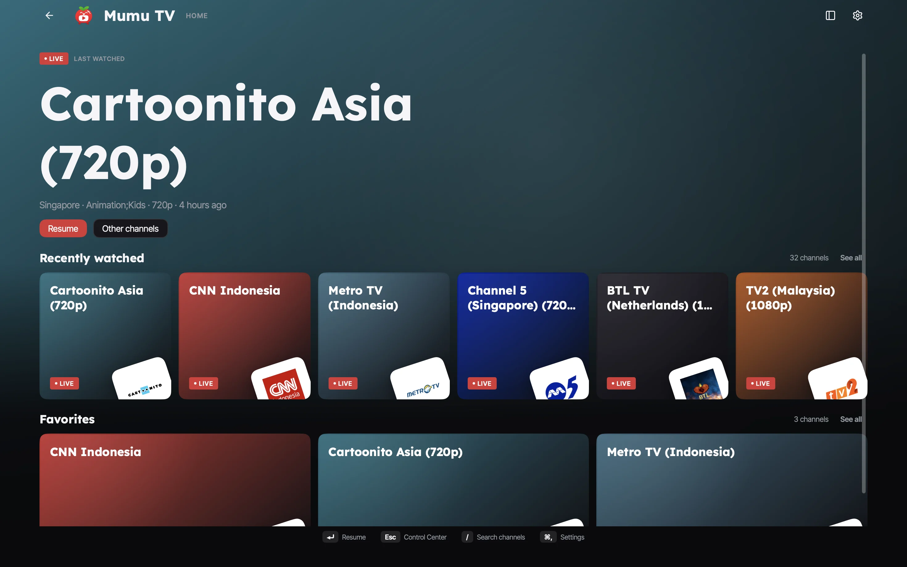
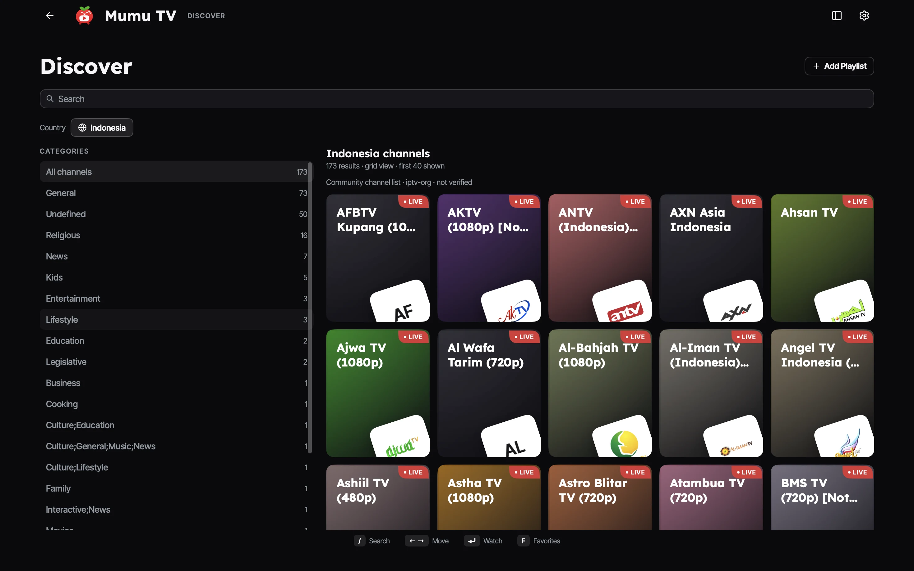
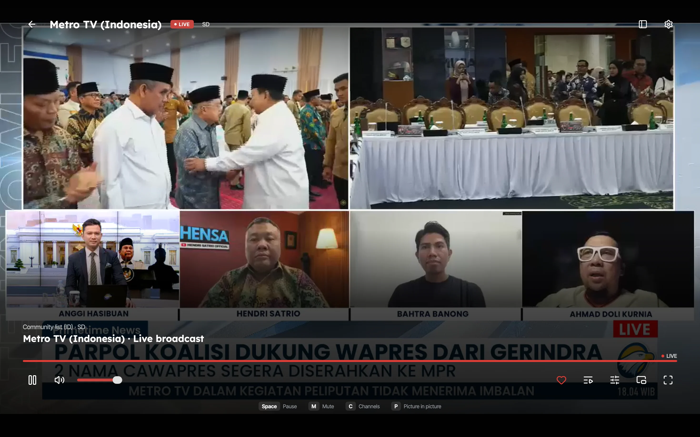
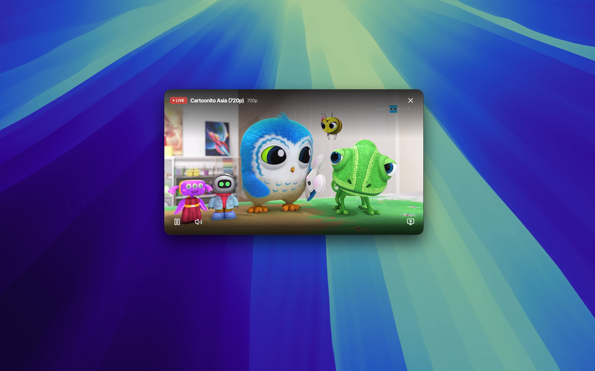
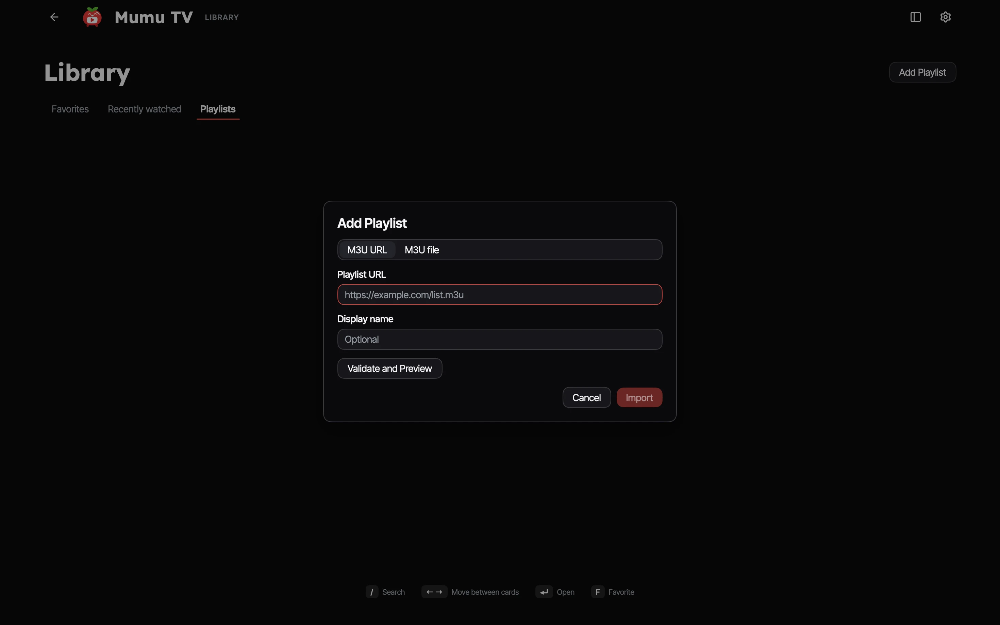

<div align="center">


# Mumu TV

**A little TV for your Mac. (Linux & Windows soon)**

A native, local-first TV player for macOS. Discover channels, bring your own
playlists, and keep watching in Picture-in-Picture.

[](https://github.com/satyawikananda/mumu/actions/workflows/ci.yml)
[](#getting-started)
[](LICENSE)

[Features](#features) · [Screenshots](#screenshots) · [Getting started](#getting-started) · [Development](#development)

</div>

> [!IMPORTANT]
> **Not every listed channel will play.** Mumu plays third-party streams; it
> does not host or control the broadcasts. Streams may be offline, have outdated
> links, or be restricted in your region. Playback also depends on your network
> connection and stream compatibility. A channel appearing in Discover does not
> guarantee availability. If playback fails, try another available stream variant
> or channel.
> Or if you have a link m3u8 or a file of m3u8, you can add it in the playlist page

[](docs/screenshots/homepage.webp)

*Your recent channels and favorites, with Resume when you choose to watch.
Mumu never autoplays on launch.*

## Features

- **Discover channels.** Choose a country, browse categories, and search the
  labelled community catalog.
- **Watch in a native player.** Pause live playback, resume at the live edge,
  and choose among the channel's available stream variants.
- **Keep watching in PiP.** Move the same playback session into a floating
  window and return to Watch without starting a second player.
- **Bring your own sources.** Import an M3U playlist from a URL or local file,
  or add a direct stream.
- **Keep your library local.** Save favorites, recent channels, playlists, and
  preferences on your Mac. No account or cloud sync required.
- **Stay in control.** Use keyboard shortcuts, the Control Center overlay,
  and Dark, Light, or System appearance.

Built with Go, [MyGo native UI](https://mygo.egoist.dev), and libmpv, with no
WebView or hosted backend.

## Screenshots

Click a screenshot to view it at full size. These captures show the development
build; channel listings and availability can change.

| Discover | Watch |
| --- | --- |
| [](docs/screenshots/discover.webp) | [](docs/screenshots/watch.webp) |
| Browse channels by country and category. | Watch with native playback controls. |

| Picture-in-Picture | Add Playlist |
| --- | --- |
| [](docs/screenshots/pip.webp) | [](docs/screenshots/add-playlist.webp) |
| Keep the current stream in a floating window. | Preview and import your own M3U playlist. |

## Getting started

Mumu targets **macOS 13 or later on Apple Silicon**. Intel Macs, Windows, and
Linux are not supported releases.

Check [GitHub Releases](https://github.com/satyawikananda/mumu/releases) for a
published Apple Silicon DMG. If no published build is available, use the
[source setup](#development) below. Tags and draft releases are not public
downloads.

### Install a published build

1. Download the DMG and `SHA256SUMS` from the same release into one folder.
2. Open Terminal in that folder and verify the download:

   ```sh
   shasum -a 256 -c SHA256SUMS --ignore-missing
   ```

   Confirm the DMG is reported as `OK` before opening it.
3. Open the DMG and drag **Mumu** into **Applications**.
4. Launch Mumu. The packaged app includes libmpv; Homebrew is only needed for
   the source setup below.

> [!IMPORTANT]
> The current packaging uses ad-hoc signing, without Developer ID signing or
> notarization. After verifying the download, try opening the app once. If
> macOS blocks it, open **System Settings > Privacy & Security > Open Anyway**
> and confirm. See the [installation details](docs/release/macos.md#unsigned-distribution)
> for troubleshooting.

### Start watching

1. On first launch, choose a country in **Discover**, or use **Add Playlist**
   to import your own source. No country is selected automatically.
2. Select a channel to open **Watch**. Add it to favorites for easy access later.
3. Press **P** or use the PiP control to keep watching in a floating window.
   Return moves the same session back to Watch; closing PiP stops playback.

In Watch, **Space** pauses or resumes, **M** toggles mute, and **C** opens the
channel drawer. Live resume reconnects at the live edge; it is not DVR or
time-shift playback.

The iptv-org catalog is a **community list**, not a rights-cleared catalog or a
guarantee that every channel works. Use sources you are authorized to watch.
Mumu does not bypass DRM, paywalls, or geographic restrictions and does not
re-host third-party video. See the [source policy](docs/architecture/sources.md).

> [!NOTE]
> Native playback and PiP have been exercised on a specific Mac configuration.
> Broader compatibility checks remain open, and the bundled runtime currently
> decodes in software. See [verified behavior and known gaps](docs/architecture/validation.md).

## Development

Use macOS on Apple Silicon and the Go version pinned in [go.mod](go.mod),
currently **Go 1.27.3**. MyGo is pinned by the project; no separate global MyGo
installation is needed.

```sh
git clone https://github.com/satyawikananda/mumu.git
cd mumu
brew install mpv
go tool mygo doctor
go tool mygo dev
```

The development app is named **Mumu Dev**, separate from an installed Mumu app.
MyGo's SQLite native module may download on first use; offline setup requires a
pre-staged module as described in the [packaging guide](docs/release/macos.md).

### libmpv for source builds (developer-only)

Source playback needs a local libmpv runtime. The Homebrew install above uses
the usual location. For a runtime elsewhere, provide its directory:

```sh
MUMU_MPV_LIBRARY=/path/to/libmpv go run ./cmd/mumu
```

Use `MUMU_MPV_LIBRARY` for `go run` and `go test`: the Go command removes
`DYLD_LIBRARY_PATH` from the binaries it runs. Without libmpv, Mumu still starts
and reports the missing runtime when you press Play.

See the [contribution guide](CONTRIBUTING.MD) for development checks and PR
workflow, [testing](docs/release/testing.md) for native QA, and
[macOS packaging](docs/release/macos.md) to build the app and DMG with
`make package`. Module boundaries are documented in the
[architecture overview](docs/architecture/README.md).

## Further reading

Explore the [documentation](docs/README.md) for architecture, UX, testing, and
release guides.

## Contributing

Code, documentation, bug reports, feature proposals, and macOS testing are
welcome. Read the [contribution guide](CONTRIBUTING.MD) for setup, project
boundaries, verification requirements, and the issue and pull request workflow.

## Code of Conduct

Help keep the Mumu community welcoming and respectful. Read the
[Code of Conduct](CODE_OF_CONDUCT.MD) for expected behavior, enforcement, and
the private reporting contact.

## Changelog

See [CHANGELOG.MD](CHANGELOG.MD) for notable changes. The current **Unreleased**
section describes the development baseline, not a published release.

## Credits

Created by [Satya Wikananda](https://github.com/satyawikananda), with thanks to
the projects that make Mumu possible:

- [MyGo](https://github.com/egoist/mygo) for native UI and application tooling.
- [mpv](https://github.com/mpv-player/mpv), [FFmpeg](https://ffmpeg.org), and
  [go-mpv](https://github.com/gen2brain/go-mpv) for media playback and Go bindings.
- [SQLite](https://sqlite.org) for local storage.
- [iptv-org](https://github.com/iptv-org/iptv) for the community channel dataset.
  Stream rights remain with their respective owners.
- [Lexend](https://github.com/googlefonts/lexend),
  [Inter Tight](https://github.com/rsms/inter), and
  [Lucide](https://github.com/lucide-icons/lucide) for typography and icons.

See [third-party notices](THIRD_PARTY_NOTICES.md) for dependency credits,
license details, and bundled runtime sources.

## License

Mumu's application code is licensed under the [MIT License](LICENSE).
Copyright © 2026 Satya Wikananda.

Bundled dependencies retain their own licenses, as listed in
[third-party notices](THIRD_PARTY_NOTICES.md). The
[Code of Conduct](CODE_OF_CONDUCT.MD#attribution) carries a separate CC BY-SA 4.0
license.
