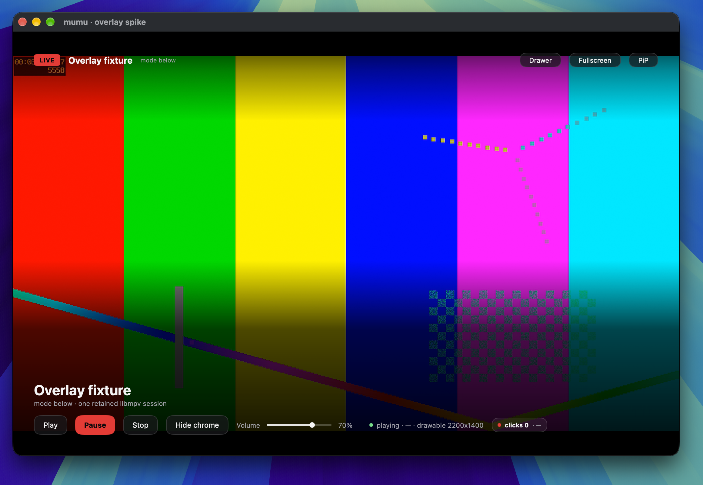

# Native video overlay evidence

Issue: [#32](https://github.com/satyawikananda/mumu/issues/32). Decision:
[ADR 0009](../../adr/0009-native-video-overlay.md). Tracker:
[#30](https://github.com/satyawikananda/mumu/issues/30).

Recorded 12 November 2026, Asia/Makassar, on the upgraded MyGo 0.9.0 baseline
from #31.

## Environment

| Item | Value |
| --- | --- |
| Machine | MacBook Air Mac15,12, Apple M3, 8 GB |
| OS | macOS 27.0.1 |
| Go | 1.27.3 |
| MyGo | 0.9.0 |
| go-mpv | 0.4.0, vendored in `third_party/go-mpv` |
| libmpv runtime | bundled LGPL build, `build/runtime/lib` |
| Stream | synthetic HLS fixture, 720p, `experiments/hlsfixture` on `127.0.0.1:18765` |

## How the run works

`experiments/overlay` creates one libmpv client and one retained
`NSOpenGLView`, then plays one stream. Three modes compare how the view meets
MyGo's rendered surface:

- `below` (candidate): attach the view to the content view, then move it under
  `MyGoSurfaceView` with `addSubview:positioned:relativeTo: NSWindowBelow`.
- `nativeview`: host the view as a `ui.NativeView` element.
- `above` (baseline): the product's current attach, view over the content.

The window root is transparent for `below` and `nativeview`, so the Metal layer
composes over the video; chrome paints scrims and bars with alpha.

## Composition



The screenshot shows the live fixture (SMPTE bars and the moving marker) with
the LIVE pill, channel name, Drawer/Fullscreen/PiP controls, the bottom meta
block and the transport bar above it. The status line reports
`drawable 2200x1400`: the hosted view is the full 1100x700 content box at 2x
backing scale.

Z-order, logged from the running app by walking `contentView.subviews`
(`subview-order.log`):

```text
subviews bottom-to-top: [NSOpenGLView MyGoSurfaceView]
```

That is the composition contract: the retained OpenGL view is the first
subview, MyGo's surface is on top of it, and MyGo's layer is created with
`setOpaque: 0`, so the video shows through pixels the view leaves transparent.

## Why `ui.NativeView` is not the production path

MyGo places native elements under its surface and, in doing so, gives them the
pointer:

- `internal/darwin/surface.go` (`hitTest:`) returns nil where a placed view
  shows, so AppKit sends the click to that view instead of the surface;
- `internal/darwin/webview.go` (`webViewAt`) decides that by geometry alone,
  with no notion of chrome painted above the placed view.

A full-bleed video element therefore swallows every click in the window,
including clicks on our own control bar. The spike keeps the mode for the
record, and the product path must insert the view itself so MyGo stays the
owner of pointer input.

## Input

Maintainer interaction on the running `below` build (12 November 2026):

| Step | Result |
| --- | --- |
| Click Hide chrome, then H | chrome hides and returns over live video |
| Click Drawer, then Esc | drawer opens above video and closes |
| Click Pause, then Resume | paused overlay appears, frame and audio stop, resume continues the same session |
| Click PiP, then Return in the panel | same session moves between windows with no reload |
| Click Fullscreen | chrome stays above video in fullscreen |

Pointer automation from the terminal was not available in this session:
`osascript is not allowed to send keystrokes. (1002)`. These steps were
performed by hand, and the click counter in the chrome is the in-app record
that the control received the press.

## Pause seam

`libmpv.Engine.SetPaused` maps to the `pause` property, and
`SetReadAhead` maps to `demuxer-readahead-secs` for this experiment.

| Observation | Result |
| --- | --- |
| Displayed frame while paused | held; the render thread draws nothing new and keeps the last presented frame |
| Audio while paused | stops; confirmed by the maintainer at the machine |
| Network read-ahead while paused | drops but does **not** stop |
| Resume | continues the same session; no reload |

Network bytes on `en0`, sampled once a second while the fixture played 720p
(`pause-network.csv`; pause began at 03:28:41, resume at 03:28:49):

```text
playing   03:28:33..03:28:38   2.85..2.91 MB/s
pause     03:28:42..03:28:48   0.03..0.30 MB/s
resume    03:28:52..03:28:57   0.10..0.33 MB/s
```

The paused rate is roughly 5% of the playing rate and not zero. `pause` alone
does not close or idle the live demuxer, and `demuxer-readahead-secs=0` did not
produce a clean zero either; the remaining traffic is playlist refresh and
in-flight segment reads. #37 has to choose the product behavior: accept the
small residual read, tear the connection and re-live-edge on resume, or hold
the last frame from a captured image. #32 records the seam and the blocker.

## Measured cost

`MYGO_FRAME_STATS=1`, `below` mode, 20 seconds with live video and full chrome
(`frame-stats.log`): 8 frames over the 8 ms threshold. Each logged frame took
9.2-14.9 ms wall time, of which build was 0.1-0.2 ms, layout 0.0-4.4 ms, paint
0.1-2.7 ms and present 3.1-14.5 ms, with 176 instances in 4 batches. The idle
window draws nothing.

No CPU or GPU claim is made beyond these samples: presenting waits on the
display's refresh, so the wall figure is not GPU cost.

## Not verified

- Radius clipping of the hosted view at the element or window corner.
- PiP drag and resize under the new composition; the summary strip was
  exercised, the panel's corner radius and drag gestures were not measured.
- Repeated PiP toggles (five and twenty times) and Spaces/fullscreen behavior
  of another app.
- Dead-stream recovery and the error panel over live video.
- Long sessions, 1080p, and CPU/GPU cost over minutes.
- Any Windows or Linux behavior: the spike builds only for darwin/arm64.
