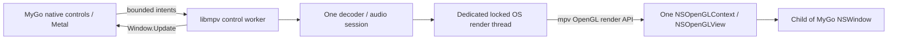

# Native playback feasibility

Decision: **CONDITIONAL GO** for a native OpenGL child surface inside MyGo on the tested Apple Silicon system. This permits further foundation work using the documented bridge; it does not establish release readiness, broad stream compatibility, zero-copy rendering, or future macOS support.

Issue: [#1](https://github.com/satyawikananda/mumu/issues/1). Related: [single-session PiP](pip-feasibility.md). Reproduction: [spike README](../../experiments/nativeplayback/README.md).

## Environment and provenance

Tested 9 November 2026, Asia/Makassar: macOS 27.0.1 (26A434), darwin/arm64, Apple M3 with 8-core GPU and 8 GiB RAM; Go 1.27.3; MyGo 0.8.3; purego 0.11.1; gen2brain/go-mpv 0.4.0. Native runtime: vegidio/binaries-mpv release 26.10.1, SHA-256 `37e93dea19e511178b7b6241f275ddefb3f3aea789351c14c4a58ac060e120a3`. Its runtime reported mpv 0.41.0, client API 2.5 and FFmpeg 9.0.2.

The workspace contained a MyGo counter starter and no `.git` metadata. Existing main application code was preserved; no commit, push, PR, or issue closure was performed.

## Implementation path

The MyGo Metal renderer and the video OpenGL context are separate surfaces composed by AppKit. No OpenGL FBO is passed to Metal, and no external mpv window/process is created. All widgets are MyGo native `ui`; `WindowOptions.Content` is set and no page/WebView is created.

`Window.NativeHandle()` supplies the NSWindow. AppKit creates/attaches/resizes the retained child NSOpenGLView on main. libmpv renders into its default framebuffer on a dedicated `runtime.LockOSThread` goroutine. Only render API/GL calls run there; synchronous client calls and event processing run on a separate worker, following `render.h`. The render callback only signals a buffered channel. Native attachment and rendering share a Go mutex and native `CGLLockContext` / `CGLUnlockContext` protection. The renderer makes the context current before each render after drawable changes. UI publication uses asynchronous `Window.Update`; shutdown cancels workers, frees the render context on its GL thread, destroys libmpv, releases native view/context references on main, then quits.

No MyGo upstream change/fork or private MyGo import is required for this prototype. There is no public native-child-widget integration here: sizing, layering, accessibility and lifetime of the child surface remain app-owned bridge work. The native UI widgets keep their ordinary MyGo identity/lifetime rules.

## Options compared

| Option | Finding |
|---|---|
| `wid` embedding | Rejected for this experiment: pinned macOS implementation/manual does not expose the needed NSView embedding contract. Never allow it to create an independent player window. |
| OpenGL render API in child NSOpenGLView | Implemented and observed inside MyGo. Hardware decode reported `videotoolbox`. macOS OpenGL is deprecated, so this is conditional. |
| Metal/IOSurface or another GPU adapter | Potential longer-term route; no direct Metal render backend in the inspected libmpv render API. No adapter or zero-copy transfer was proven. |
| Software render / CPU frame copy | Available in the binding but not used. Since native GL works, no software fallback was benchmarked or approved for production. No performance claim is made for it. |

## Observations and measurements

Original synthetic HLS fixtures were generated locally using FFmpeg 8.1.1/libx264 and AAC. 720p and 1080p rolling live playlists were served on loopback. The initial 720p file-based HLS test was VOD and is explicitly separate from the subsequent live tests.

| Run | Sampled abs A/V sync, median / max | Whole-process CPU, median / max | Maximum sampled RSS |
|---|---:|---:|---:|
| Live 720p | 0.005 / 18.649 ms | 9.4 / 72.9% | 191.28 MiB |
| Live 1080p | 0.005 / 7.822 ms | 11.8 / 76.0% | 180.63 MiB |
| Extended 1080p lifecycle | 0.005 / 109.839 ms | 14.45 / 83.0% | 181.78 MiB |
| Final 1080p lifecycle | 0.004 / 10.456 ms | 13.4 / 91.7% | 150.25 MiB |

Sources: `720p log` (local run artifact, not committed), [720p process samples](evidence/live720/process.csv), `1080p log` (local run artifact, not committed), [1080p process samples](evidence/live1080-process.csv). These short, single-machine samples include startup, transitions and teardown. CPU comes from `ps` at roughly 0.5-second intervals; it is not an isolated decoder benchmark. The separate fixture encoder and other apps were running. RSS is resident memory, not total physical footprint or VRAM. A/V sync is libmpv telemetry sampled once per second, not a measurement of audible lip-sync or every frame.

The extended and final runs are retained in `extended1080` (local run artifact, not committed) and `final1080` (local run artifact, not committed), with adjacent `process.csv` files. The final run includes renderer-error propagation and compact PiP status; no renderer fault was injected. Different runs are not statistically comparable. [Measured summary](evidence/measured-summary.json) records derived values after assertions checked one session, one load and one retained view/context per trace.

Both resolutions reported `vo=libmpv`, `ao=avfoundation`, AAC audio, `hwdec=videotoolbox` and zero sampled decoder-frame drops. Initial runs did not measure GPU utilization. Follow-up runs below add system-wide GPU observations; utilization per process, GPU memory, thermal behavior and power consumption remain unmeasured. Hardware decode selection does not establish a zero-copy path.

The agent visually inspected video within a native MyGo window through computer-use capture. The maintainer initially confirmed audible beeps and moving PiP video. In follow-up QA they explicitly confirmed continuous audio and perceptually synchronized flash/beep after Return/PiP actions. Some computer-use captures failed with ScreenCaptureKit errors `-3811`/`-3812`; later process-filtered recordings succeeded. Initial screenshots remain in the conversation; follow-up frames are archived below.

### Follow-up acceptance evidence

[Follow-up QA](evidence/followup-qa.md) records commands, calibrated capture analysis, human observations and limitations. The optional fixture tone at 220 Hz makes audio gaps observable between the 880 Hz pulses. A standalone Swift/ScreenCaptureKit diagnostic records only the selected spike process, without microphone capture; it is separate from the Go application.

| Captured run | Paired flash/beep observations | Audio minus video, median / range | Whole-system GPU device utilization, prelaunch median / exercise median / exercise max |
|---|---:|---:|---:|
| 720p with CGL locking | 16 | -15.313 / -131.980 to -15.313 ms | 2 / 29 / 48% |
| 1080p with CGL locking | 14 | -44.188 / -60.855 to -27.521 ms | 20 / 35 / 56% |

Sources: [720p analysis](evidence/continuous720-cgl/analysis.json), [1080p analysis](evidence/continuous1080-cgl/analysis.json), [summary and capture hashes](evidence/followup-summary.json). Negative offsets mean captured audio leads captured video. These include transitions, not just steady playback. Video sampling is 60 Hz; audio windows are 10 ms. A generated +120 ms calibration measured a median +118 ms; the automated calibration also detects a known mute and black interval.

Both captures contain the deliberate approximately 990 ms volume-zero test and initial loading silence. No additional low-audio interval of at least 20 ms was detected during the analyzed playing portion. This threshold applies to the captured tone, not physical audio hardware. Each capture also ends with a 10 ms audio boundary interval. The captured video contains repeated images up to 317 ms at 720p and 400 ms at 1080p. Entire filtered-window images disappear during some native resize/fullscreen transitions, up to 2.783 s and 1.483 s respectively; these cannot be attributed solely to player blackout. Capture/compositor behavior remains a measurement limitation.

GPU counters come from `ioreg`'s `AGXAccelerator` `PerformanceStatistics`, with six prelaunch samples and samples throughout the exercise. The encoder, recorder, desktop and other applications contribute. Different baselines and sample counts prevent resolution comparisons or attribution to mumu alone. `xctrace` was unavailable. The requirement for GPU observations is met; a per-process GPU benchmark is not claimed.

Archived frames: [720p main](evidence/continuous720-cgl/main.png), [720p PiP](evidence/continuous720-cgl/pip.png), [1080p PiP](evidence/continuous1080-cgl/pip.png). Full recordings remain in the ignored local `build/spike-captures/` directories, with SHA-256 recorded in the summary.

## Failure evidence and constraints

- `Initial 720p diagnostic` (local run artifact, not committed): an early implementation coupled render/client work and synchronous UI publication; fullscreen yielded an A/V sync sample of about four seconds. It is not the accepted threading design.
- Final rendering and client work are separate. The 1080p run still logged render gaps of 116–378 ms around transitions, excluding startup idle. This does not justify a seamless-frame-delivery claim even though sampled A/V sync recovered/stayed small.
- The initial PiP close handler blocked app quit after media teardown. The guard now permits native close during final quit; final sampler runs returned exit 0. Obsolete test processes had to be force-terminated after their decoder teardown; those are distinct from passing final runs.
- Follow-up recording exposed a `native SIGSEGV immediately after PiP attachment` (local run artifact, not committed). A Go mutex did not cover AppKit's own context access. Native CGL context locking and rebinding before rendering were added following [Apple's OpenGL threading guidance](https://developer.apple.com/library/archive/documentation/GraphicsImaging/Conceptual/OpenGL-MacProgGuide/opengl_threading/opengl_threading.html). Two resolution runs and a repeated 1080p capture then exited 0 with one session each. This supports the mitigation, not a universal explanation for every driver failure. An unrecoverable CGL unlock/cleanup-lock error exits the diagnostic process with an explicit fatal message rather than attempting mpv destruction with a live render context; that fault path was not injected.
- A missing/incompatible dylib fails in binding package init, before the app can show an error. `nocgo` avoids a C compiler for this app, not dynamic libraries or architecture/ABI requirements.
- `Unreachable-source exercise` (local run artifact, not committed) records the failed load and subsequent lifecycle handling. A connection failure is distinct from unsupported-codec, malformed-HLS, TLS, or prolonged-stall tests; those additional cases are not proven here.
- Network timeout/demux cache limits bound the spike. Production remote-catalog validation, credential handling, redirects, local-network policies and multi-source generation cancellation belong to later approved issues.
- Spaces, foreign fullscreen, pointer drag and app hide/unhide were confirmed by the maintainer on this configuration. Sleep/wake, different monitors/scale factors, long-duration playback, non-H.264 codecs, HTTPS providers and shipping/notarization remain further QA.

## Licensing and loading

The Go binding's MIT license does not cover libmpv or its dependencies. libmpv is LGPL-2.1-or-later or GPL-2.0-or-later depending on enabled components; FFmpeg and codecs have their own build-dependent obligations. The existing fixture FFmpeg advertises GPL components. Treat the downloaded runtime as a development input only, retain its provenance, audit actual native build flags/source/license notices, and choose a compliant redistribution strategy in packaging issue #14. No dylib was added to the repository or application distribution.

Sources: [binding v0.4.0](https://github.com/gen2brain/go-mpv/tree/v0.4.0), [mpv v0.41.0 render API](https://github.com/mpv-player/mpv/blob/v0.41.0/include/mpv/render.h), [OpenGL requirements](https://github.com/mpv-player/mpv/blob/v0.41.0/include/mpv/render_gl.h), [MyGo v0.8.3 window API](https://github.com/egoist/mygo/blob/v0.8.3/window.go), [runtime release](https://github.com/vegidio/binaries-mpv/releases/tag/26.10.1).

## Issue acceptance status

- [x] Binding loads/decodes HLS at both resolutions; captured flash/beep analysis and maintainer confirmation establish audible synchronization on the tested setup, with transient offsets documented.
- [x] Video observed within one native MyGo window.
- [x] No HTML/JS/WKWebView/browser player/external mpv window used.
- [x] Resize, fullscreen, teardown, decoder/audio selection, CPU/RSS, whole-system GPU observations and failure scenarios recorded. GPU attribution is explicitly limited.
- [x] Native integration constraints and upstream/fork requirement assessed.
- [x] Conditional decision and recommended implementation path recorded.

Recommendation: retain the child-surface boundary for foundation work, keep OpenGL replaceable, and require better presentation smoothness, broader native lifecycle QA, runtime-loader UX and license review before calling production playback complete. M0 acceptance evidence is complete for this tested configuration; the decision remains CONDITIONAL GO because these production risks remain.
