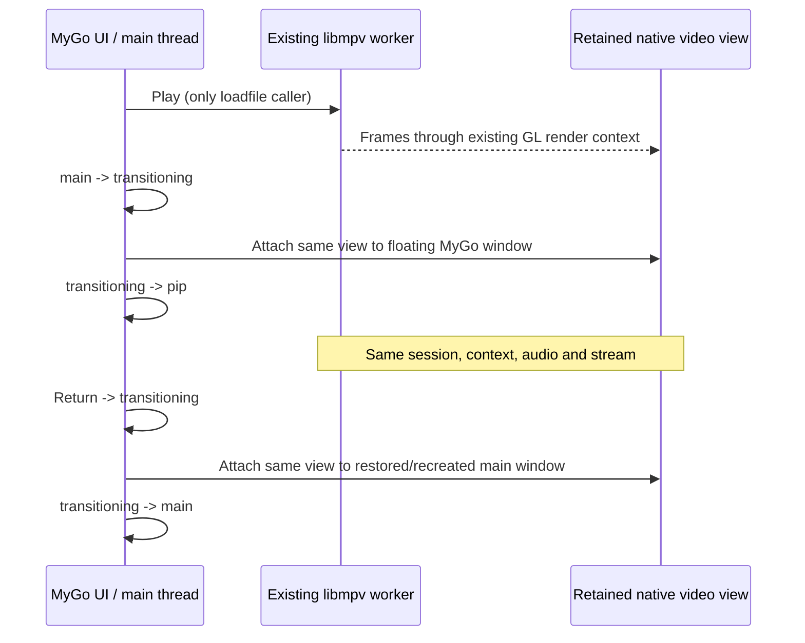

# Single-session native PiP feasibility

Decision: **CONDITIONAL GO** on the tested macOS/Apple Silicon configuration. A retained native video view/context can move between MyGo windows without deliberate stream reload. Follow-up QA confirms Spaces/stacking and perceptual audio continuity on this Mac; production-level seamlessness across configurations is not established.

Issue: [#2](https://github.com/satyawikananda/mumu/issues/2). Dependency: [native playback decision](native-playback-feasibility.md). Reproduction: [spike README](../../experiments/nativeplayback/README.md). Environment and runtime provenance are identical to that playback report.

## Ownership and event sequence

Exactly one `mpv.New()` call and one render context exist for a spike run. One NSOpenGLView is explicitly retained independently of its superview. PiP moves that same view, not another preview. Controls dispatch intents to the existing client worker; entering/leaving PiP never sends `loadfile` or creates another decoder.

Attachment first validates the target content view, locks the surface and its native CGL context against rendering, reparents the view, reattaches its GL drawable, updates backing-pixel size, and signals redraw. The render thread makes its context current before drawing. Logical presentation commits after attachment succeeds. The unit-tested state helper rejects invalid/stopped/reentrant transitions, treats duplicate transitions as no-ops, and rolls back logical state on attachment failure. Unexpected AppKit exceptions/context loss are not modeled as successful recovery.

The floating window uses native MyGo `Content`, `Panel: true`, `AlwaysOnTop: true`, a native titlebar and resize/move behavior. Initial video is 480×270 points plus 78 points of controls. Resize adjusts content height to retain a 16:9 video region. No parent relationship is assigned: MyGo child windows intentionally hide with their parent, which would defeat PiP during main hide/minimize.

## Deterministic policies

| Event | Implemented policy | Evidence / limit |
|---|---|---|
| Enter PiP | Move retained view into floating window; main shows PiP placeholder | Native handles and session/load counters in logs; maintainer saw moving video |
| Return | Restore/show main; recreate it if it was closed; reattach view; hide PiP | Extended exercise |
| Close PiP, main present | Return to main, including restoring minimized/hidden main | Extended exercise |
| Close main during PiP | Close main; keep decoder/view and PiP alive | Live 720p/1080p exercises |
| Close PiP, no main | Cancel playback, free render context, destroy decoder, release native view, quit | Final logs + sampler exit 0 |
| Close main during main playback | Cancel/free/quit through same shutdown path | Follow-up computer-use close action; process exit 0 and teardown in manual trace |
| Main hide/minimize during PiP | Keep independent floating window and audio session | Repeated captured exercises, with continuous-tone analysis |
| Main fullscreen enter/exit | Use MyGo native fullscreen; same libmpv session | Live logs; render gaps measured, no seamlessness claim |
| PiP resize/move | Native window operations; update view size, preserve video ratio | Maintainer confirmed pointer drag/resize with moving video; native move/resize callbacks in manual trace |
| App Quit | Guard against repeated shutdown; wait for workers, release on main, allow native close | Final process exit 0; early blocked-close bug documented in playback report |
| Spaces / another app's fullscreen / other app foreground | PiP remains visible above the other application with moving video | Maintainer explicitly confirmed all three cases on this Mac |
| App hide / unhide | Hide the app's windows while playback continues; restore PiP on unhide | Maintainer confirmed Cmd+H, continuing audio and moving PiP after reopening through Dock |
| Sleep/wake / external displays | No proven recovery guarantee | Not tested |

`stopped` is terminal presentation during shutdown. Media failure is shown as an error, including in the compact PiP controls. A fatal renderer error is sent to the actor and ends the session; it must not keep reporting playing. Renderer-loss injection was not performed.

## Observed continuity

The [720p live trace](evidence/live720/playback.log) and [1080p live trace](evidence/live1080.log) each contain one session creation, one start-file/file-loaded sequence and `loads=1` throughout transitions. Native view and GL-context addresses stay identical while target NSWindow addresses change. `time-pos` continues advancing and audio remains on the same `avfoundation` backend. Initial human observations established audible beeps and moving PiP video. Follow-up QA adds continuous-tone capture and explicit perceptual continuity/synchronization confirmation; physical sample-accurate audio continuity is not claimed.

| Live trace | First PiP attachment | Return attachment | Next PiP attachment |
|---|---:|---:|---:|
| 720p | 73.816 ms | 64.079 ms | 31.918 ms |
| 1080p | 82.941 ms | 55.333 ms | 55.814 ms |

These are wall-clock native attachment operations, including window operations/lock wait. They are not black-frame duration or audio interruption measurements. The 1080p trace logged non-startup render gaps up to 377.786 ms, and the 720p trace up to 233.226 ms. Timer delivery, UI transitions, process load and GL synchronization can contribute. Sampled A/V sync was much smaller; neither metric alone establishes perceived seamlessness.

The later [extended trace](evidence/extended1080/playback.log) covers Close PiP with main, mute via volume zero/restore, hide/minimize, PiP movement/resize, Return after main destruction and final no-main close. Earlier resource tables intentionally refer to their named runs; the extended trace is additional lifecycle evidence.

The earlier [final trace](evidence/final1080/playback.log) repeats that expanded sequence on the pre-capture implementation. It reports `visible=true always_on_top=true` for active PiP, volume `0` then `30`, identical native view/context addresses across seven transfers, continued playback after main recreation, and complete teardown. The sampler returned exit 0. First-window attachment took 221.595 ms and later transfers 20.554–53.501 ms in that run. These measurements do not establish cross-app stacking or human-perceived interruption duration.

### Follow-up capture and human QA

The initial checklist overclaimed completion of audio continuity using handle/position logs alone. It was treated as partial until this follow-up obtained direct capture analysis and human observations.

[Follow-up QA](evidence/followup-qa.md) links the [720p](evidence/continuous720-cgl/playback.log), [1080p](evidence/continuous1080-cgl/playback.log), repeated-capture and [manual](evidence/manual-followup.log) traces. Recording exposed a native render crash after reparenting, documented in the playback report. Native CGL locking now complements the Go mutex. Three subsequent captured exercises, each with seven transfers, exited 0 and preserved one session/load/view/context per run. The normal-path success supports this mitigation; unrecoverable context loss is still a native failure boundary.

Continuous-tone analysis sampled audio in 10 ms windows and found no additional low-audio interval of at least 20 ms during the analyzed playing portion, apart from the intentional volume-zero test, initial loading and the capture boundary. Captured video has repeated-image intervals up to 317 ms at 720p and 400 ms at 1080p. Whole filtered windows also disappear during some native resize/fullscreen transitions. Those capture gaps cannot establish the duration of a player-only blackout. Full recordings and hashes are indexed in the follow-up report.

The maintainer confirmed drag/resize with moving video, PiP above a foreground application, switching Desktop/Space, another app's fullscreen, continuous audio and synchronized beep/flash after Return/PiP actions. They also confirmed app hide/unhide behavior. Native callback logs supplement these human observations; the agent did not independently hear physical output or capture private content from other applications.

## Alternatives and next gate

Keep the native-child-surface adapter separate from player lifetime. If a future macOS version cannot migrate this GL drawable, report the failed configuration and keep PiP blocked there. Investigate a new native compositor/IOSurface bridge or an approved MyGo extension. Do not silently reload the stream, add a second decoder, switch to a WebView, or spawn mpv externally.

Before production PiP issue #12 is complete, resolve or bound the observed visual gaps, repeat lifecycle QA across supported configurations, test sleep/wake and monitor-scale behavior, measure long-session resource behavior, and define a plan for deprecated OpenGL. A standard AVKit system PiP controller was not used or claimed; this is a native floating mini player.

## Issue acceptance status

- [x] Native MyGo PiP prototype with no WebView.
- [x] One logical libmpv session and retained renderer throughout transfer, evidenced by handles/events.
- [x] Stream position preserved without transfer reload; continuous-tone measurements, human audio confirmation and visual interruption/measurement limits documented.
- [x] Close/return/hide/minimize/fullscreen/Spaces/quit behavior exercised on the tested Mac, with human cross-Space/foreign-fullscreen and app hide confirmation.
- [x] Native resize/move and always-on-top behavior observed through maintainer pointer/stacking QA and native callbacks.
- [x] Native ownership, reproducible tests and conditional decision documented.

M0 acceptance evidence is complete for the tested configuration. The conditional decision preserves the native graphics, capture and production QA risks; production PiP remains separate work.
