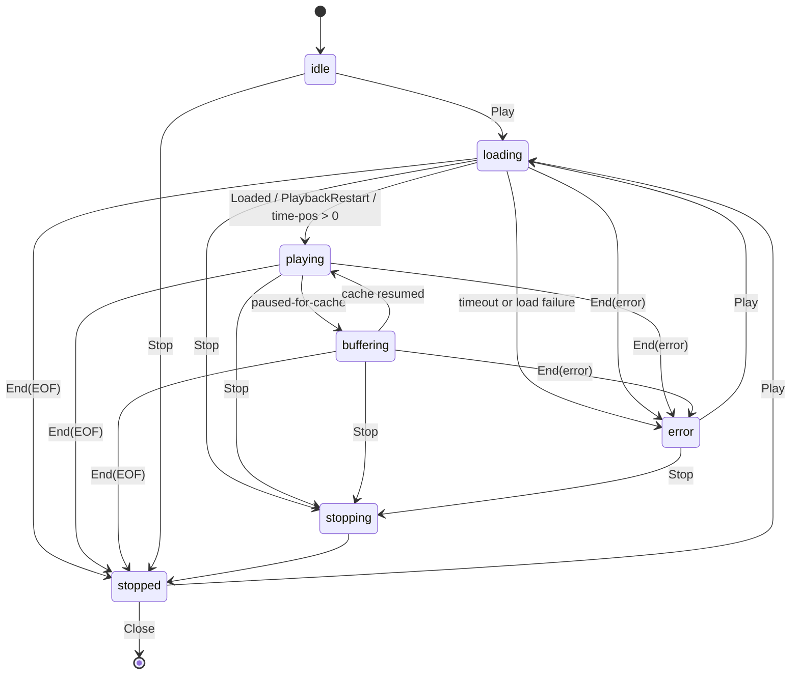

# Playback controller

Issue: [#5](https://github.com/satyawikananda/mumu/issues/5). Decision:
[ADR 0005](adr/0005-playback-controller.md). Feasibility evidence:
[native playback](native-playback-feasibility.md).

`internal/player` owns playback state, intents and teardown. It does not own
MyGo screens or the native video surface. `internal/video` remains the
presentation boundary; its native adapter lands with #11.

## States



`StateUnknown` is the zero value. `stopped` still accepts `Play`; `Close` is
terminal.

## API

```go
controller := player.New(engine,
    player.WithLoadingTimeout(20*time.Second),
    player.WithFullscreenHandler(func() { /* dispatch to the window */ }),
)

controller.Subscribe(func(snapshot player.Snapshot) {
    // Runs on the notifier goroutine. Dispatch to MyGo:
    // window.Update(func() { app.player = snapshot })
})

err := controller.Play(player.Source{URL: "https://example.com/live.m3u8"})
err = controller.SetVolume(30)
err = controller.SetMuted(false)
err = controller.RequestFullscreen()
err = controller.Stop()
err = controller.Close(ctx)
```

`Play`, `Stop`, `SetVolume` and `SetMuted` enqueue intents and return
promptly. The intent queue is bounded. Multiple `Play` intents in one drain
keep only the newest, so rapid selection does not load every intermediate
channel.

## Stale events and generations

Every `Play`, `Stop` and `Close` increments a generation. Engine events and
metrics carry that generation. The controller drops anything from an older
generation. The libmpv adapter adds a second filter:

1. `CommandAsync` uses the generation as `replyUserdata`; only the matching
   command reply opens the event barrier.
2. `playlist_entry_id` from that reply is compared with `StartFile` and
   `EndFile` events.

A late `End` from the previous source cannot stop the new one.

## Threading

| Goroutine | Responsibility |
|---|---|
| actor | intents, state transitions, generation, timers |
| notifier | copies snapshots and calls subscribers |
| libmpv pump | every client API call, event wait and property poll |

The UI never calls libmpv. Subscribers never touch widgets; the app wraps them
in `Dispatcher.Update`. Loading and network waits never run on the main
thread.

## Libmpv adapter

`internal/player/libmpv` uses pinned `gen2brain/go-mpv` 0.4.0 through the local
patch in `third_party/go-mpv` (a `replace` in `go.mod`), and the real adapter is
part of the **default `darwin/arm64` build**. `darwin/amd64`, `linux` and
`windows` compile a stub that reports `player.ErrRuntimeUnavailable`, so
cross-builds stay free of native code. No build tag is needed; the old
`mumu_mpv` tag is accepted but has no effect. CGO is not required.

Upstream 0.4.0 opens libmpv from a package `init()` and panics when the dylib is
missing (`purego_darwin.go`), which would crash every launch on a machine
without mpv. The patch replaces that init with `mpv.Load(candidates)`: it
resolves the first working candidate, registers the entry points, checks
`mpv_client_api_version` (major 2, minor 1 or newer) and returns an error
instead of panicking. Loading is retryable, so installing mpv and pressing
Retry works without restarting the app.

`internal/player/libmpv/library` owns the search order, uses injected
`Exists`/`Open` functions and is unit-tested without a dylib:

1. `MUMU_MPV_LIBRARY`, a dylib file or `:`-separated directories;
2. the dynamic loader's own path, which honours `DYLD_LIBRARY_PATH`;
3. `/opt/homebrew/lib`, then `/usr/local/lib`;
4. `Contents/Resources` next to the executable, only when it already exists
   (packaging and redistribution stay #14).

`MUMU_MPV_LIBRARY` exists because the `go` command strips `DYLD_LIBRARY_PATH`
from the binaries it runs, so `go test` cannot rely on the loader path. Errors
name the library files that were tried and never a full path, so a log line
cannot reveal where the app was launched from.

Engine, controller and video surface are created on the **first Play**, not at
launch: a launch never opens the runtime, logs a playback warning or shows a
playback error. A missing runtime surfaces as one actionable Watch message.

```sh
go build ./cmd/mumu
DYLD_LIBRARY_PATH=/private/tmp/mumu-runtime/lib ./mumu
```

Default options follow M0: `config=no`, `load-scripts=no`, `ytdl=no`, no
terminal/input bindings, `idle=yes`, `keep-open=no`, `network-timeout=10`,
`demuxer-max-bytes=32MiB`, `hwdec=auto-safe`, and `vo=null` for headless
control. `hwdec-current`, `current-vo` and `current-ao` are reported, not
assumed.

## Smoke test

The fixture and runtime from `experiments/nativeplayback/README.md` are
required. Both tests need `MUMU_MPV_LIBRARY` (or an installed runtime) because
`go test` drops `DYLD_LIBRARY_PATH`; a skip is not a passing result.

```sh
/private/tmp/mumu-hlsfixture -seconds 30

MUMU_MPV_LIBRARY=/private/tmp/mumu-runtime/lib \
MUMU_HLS_TEST_URL=http://127.0.0.1:18765/index.m3u8 \
  go test -run TestIntegrationHLS -v ./internal/player/libmpv
```

`TestIntegrationEngineCreateLoadStop` (gated by `MUMU_MPV_TEST=1`) creates a
real engine, loads a local playlist, receives a load event, stops and closes.

```sh
MUMU_MPV_LIBRARY=/private/tmp/mumu-runtime/lib MUMU_MPV_TEST=1 \
  go test -run TestIntegrationEngineCreateLoadStop -v ./internal/player/libmpv
```

The HLS test verifies load, playing, volume, mute, stop and close over a
synthetic H.264/AAC HLS stream. It does not render video and does not claim
universal codec support or hardware decoding. The recorded run is
[player-controller-smoke.log](evidence/player-controller-smoke.log).

## Limitations

- No native video surface in #5; Watch/PiP presentation belongs to #11/#12.
  The render port and the darwin child-surface adapter are described in
  [native video surface](video-surface.md).
- No seek/reverse API in v0.1. Live streams are not assumed seekable.
- Native teardown can outlive `Close` when a context deadline expires.
- Event ordering is tested against the pinned libmpv runtime, not every
  version.
