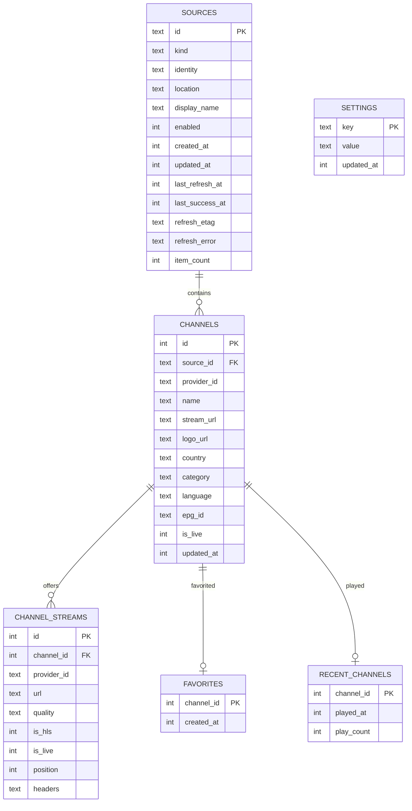

# Local storage

Issue: [#6](https://github.com/satyawikananda/mumu/issues/6). Decision:
[ADR 0004](adr/0004-local-sqlite-storage.md).

mumu stores user-owned data on-device in SQLite. There is no account, hosted
backend or cloud sync. The app opens the library during MyGo's `WhenReady`
callback and shows an actionable error banner if it cannot.

Storage uses the official `github.com/egoist/mygo/plugins/sqlite` connection.
The plugin is cgo-free and its native library is bundled by `mygo build`.
WAL, `synchronous=NORMAL` and foreign keys are applied after open. A
store-level mutex serializes read-modify-write sequences, and compound writes
use `DB.Transaction` batches because the plugin has no interactive transaction.

## Location and permissions

```text
~/Library/Application Support/Mumu/mumu.db
```

The database file is `0600`. Missing parent directories are created. A
corrupt, unrecognised or newer library is never deleted automatically.

## Schema



`provider_id` is an explicit playlist/provider identifier when available,
otherwise a hash of the canonical stream URL. Display names are never used as
identity. The unique pair `(source_id, provider_id)` lets two playlists contain
the same name or URL without overwriting each other.

`channel_streams` holds every playable variant of a channel. Its provider ID is
unique within the channel, `position` keeps playlist order, and `headers` stores
only the accepted `User-Agent` and `Referer` values. `channels.stream_url`
remains the primary variant for existing queries.

`source.id` is derived from source kind and `identity`. `identity` is the
credential-free location: scheme, host and path for URLs, or the cleaned
absolute path for local files. Rotating a query token does not change the
source ID, so favorites survive a re-import.

`last_refresh_at` records the latest attempt, `last_success_at` the latest
successful replace, and `refresh_error` a user-safe failure message. A failed
attempt never changes `last_success_at`, `item_count` or channel rows.

## Atomic refresh

```go
result, err := store.Channels().ReplaceForSource(ctx, sourceID, batch, storage.RefreshMeta{
    RefreshedAt: time.Now(),
    ETag:        etag,
    ItemCount:   len(batch),
})
```

`ReplaceForSource` runs in one transaction:

1. upsert channels by `(source_id, provider_id)`;
2. delete and reinsert the source's stream rows;
3. delete channels that disappeared from the playlist;
4. record refresh metadata.

Favorites and recent entries reference the channel row, not the stream row.
A channel with a stable provider ID keeps its local ID and therefore its
favorites. A channel that truly disappeared is removed by cascade and leaves no
dead link.

## Repositories

```go
store, err := storage.Open(ctx, path)
defer store.Close()

source, err := storage.NewSource(
    storage.SourceRemotePlaylist,
    "https://example.com/list.m3u",
    "Example",
)
saved, err := store.Sources().Upsert(ctx, source)

err = store.Channels().UpsertMany(ctx, saved.ID, []storage.Channel{
    {
        ProviderID: "news-1",
        Name:       "News",
        StreamURL:  "https://stream.example/news.m3u8",
        Live:       true,
    },
})

channel, found, err := store.Channels().FindByProvider(ctx, saved.ID, "news-1")
err = store.Favorites().Add(ctx, channel.ID, time.Now())
err = store.Recent().MarkPlayed(ctx, channel.ID, time.Now())
err = store.Settings().Set(ctx, "region", "ID")
```

`Recent` is bounded to 100 rows. `MarkPlayed` must be called only after
playback genuinely reaches `playing`; a click alone is not recent activity.

## Migrations

Migrations are embedded SQL files in `internal/storage/migrations`, applied
in version order. The adapter splits each file into single statements and runs
them with its `schema_migrations` row in one batch transaction, so a failure
leaves the previous version intact.

Policies:

- never delete or rewrite user data to recover from an error;
- never apply a migration when the database version is newer than the binary;
- never treat an unversioned database with user tables as empty;
- add new schema in a new migration, do not edit an applied migration.

## Credentials

- Source URLs with `user:pass@` are rejected. There is no plaintext credential
  column.
- Only `User-Agent` and `Referer` playback headers are stored, in
  `channel_streams.headers`, bounded to 4 KiB. `Cookie`, `Authorization` and
  `Proxy-*` are rejected or ignored. A later issue may add a Keychain-backed
  credential reference for authenticated sources.
- `refresh_error` must be user-safe and credential-free; callers sanitize it.
- Logs never include source URLs, tokens or header values.

## Cache

Payload/catalog caching is intentionally **not implemented** in #6. There is
no cache table, so there is no unbounded cache. #8/#10 own catalog fetching,
freshness and offline fallback. If a bounded cache is added later, it gets a
new migration and remains disposable and separate from user-owned data.

## Verification

```sh
go test ./internal/storage ./internal/app
go test -race ./internal/storage ./internal/app
```
